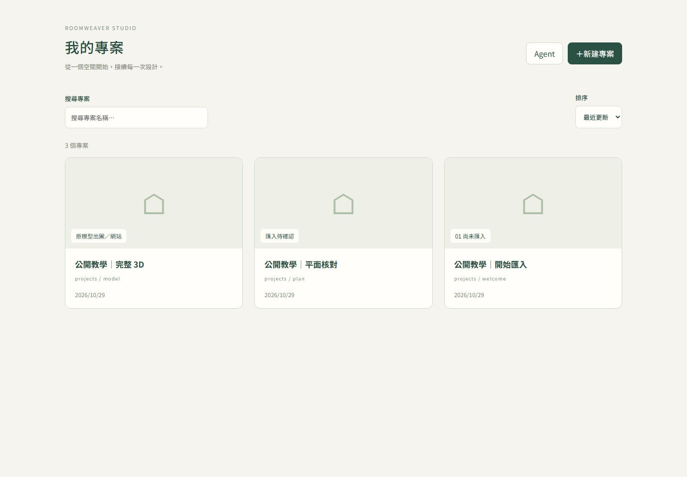
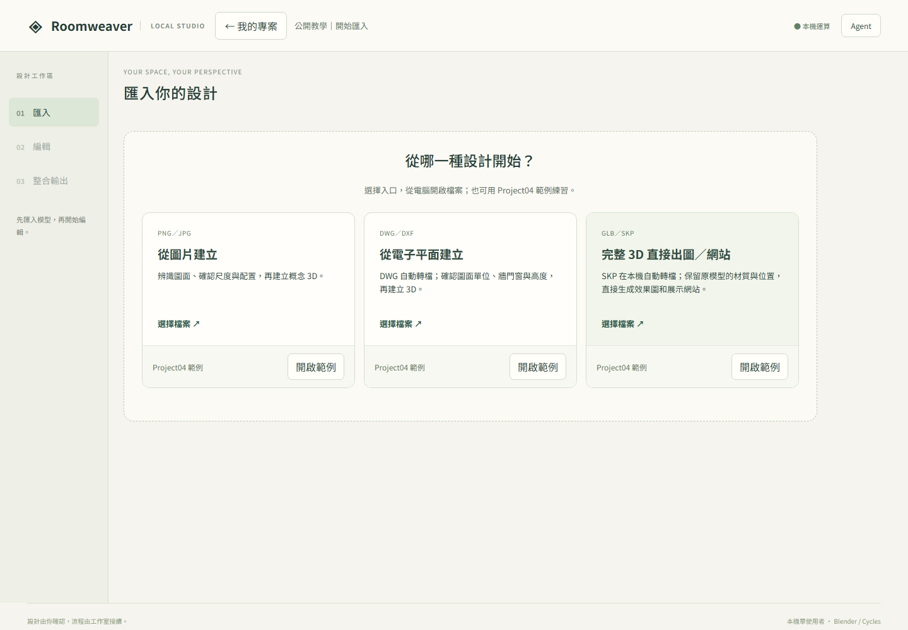
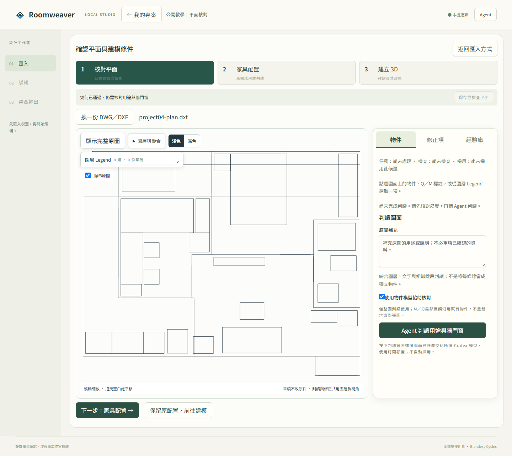
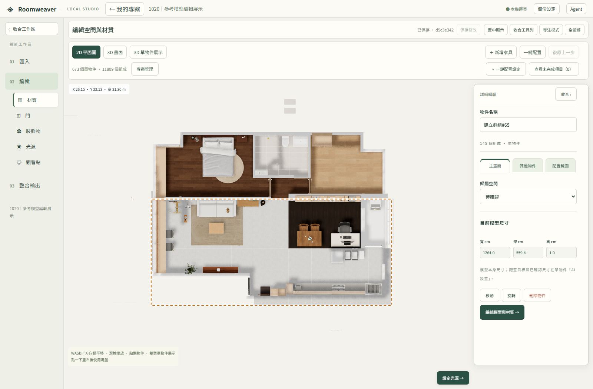
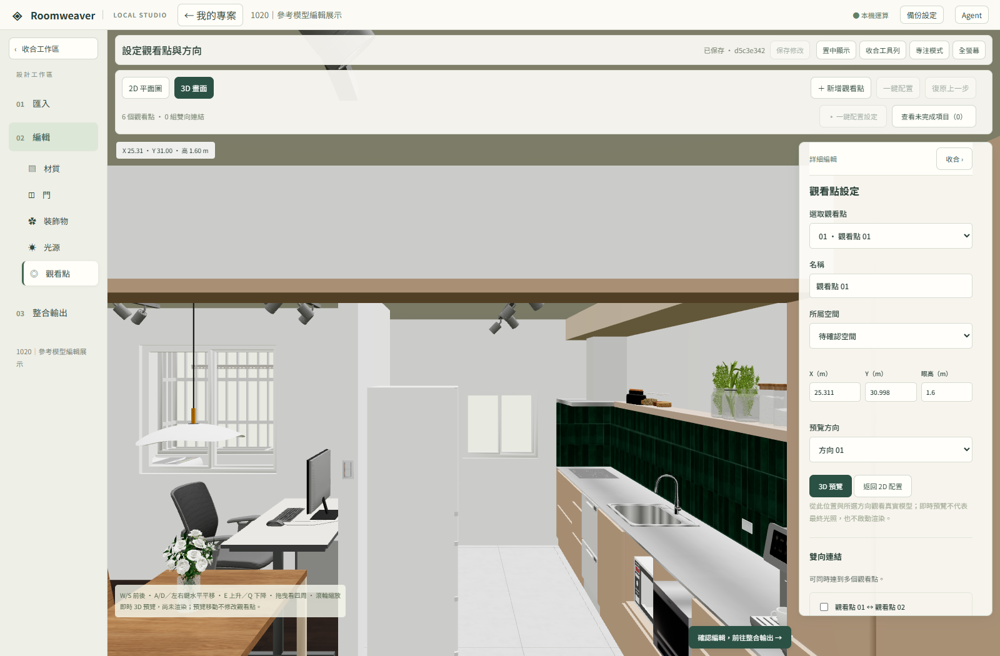
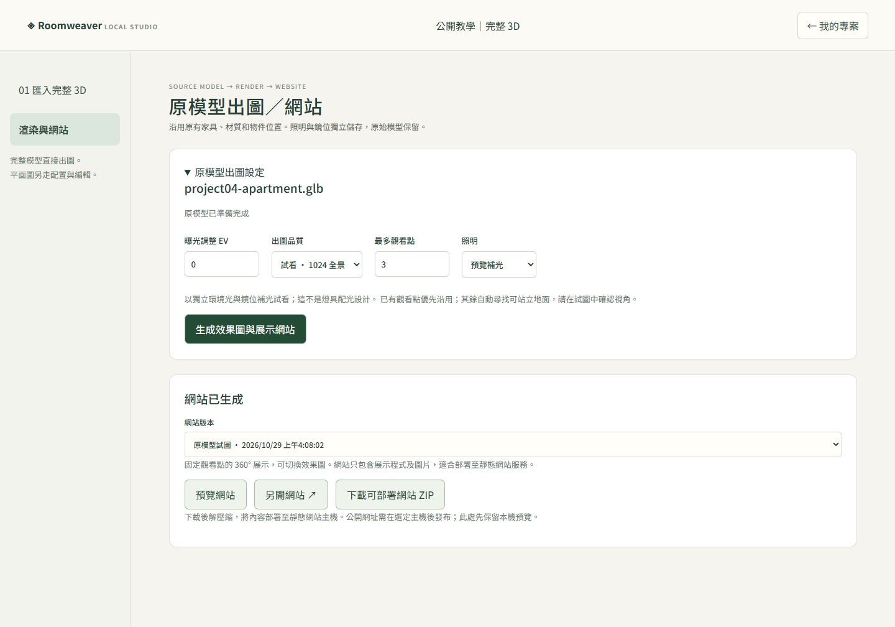
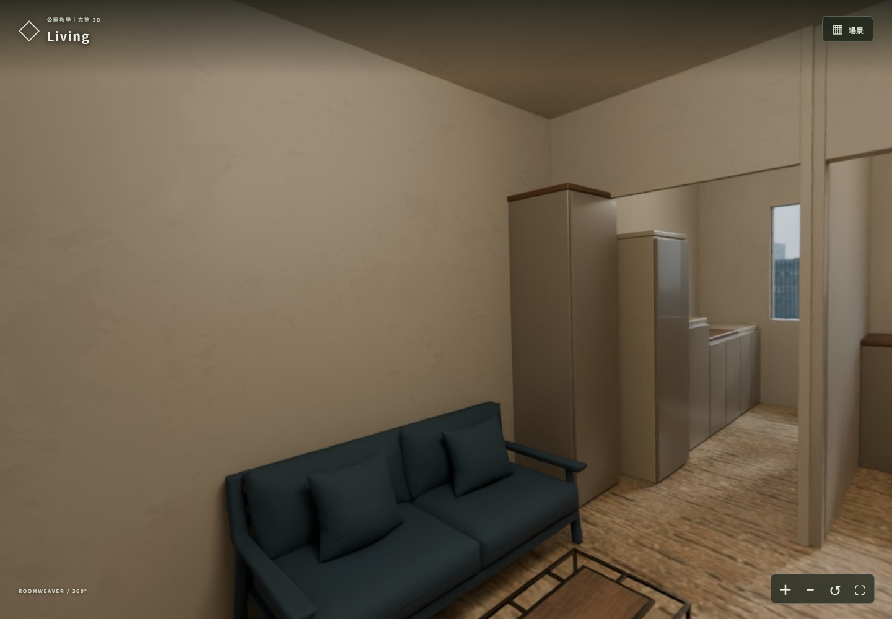
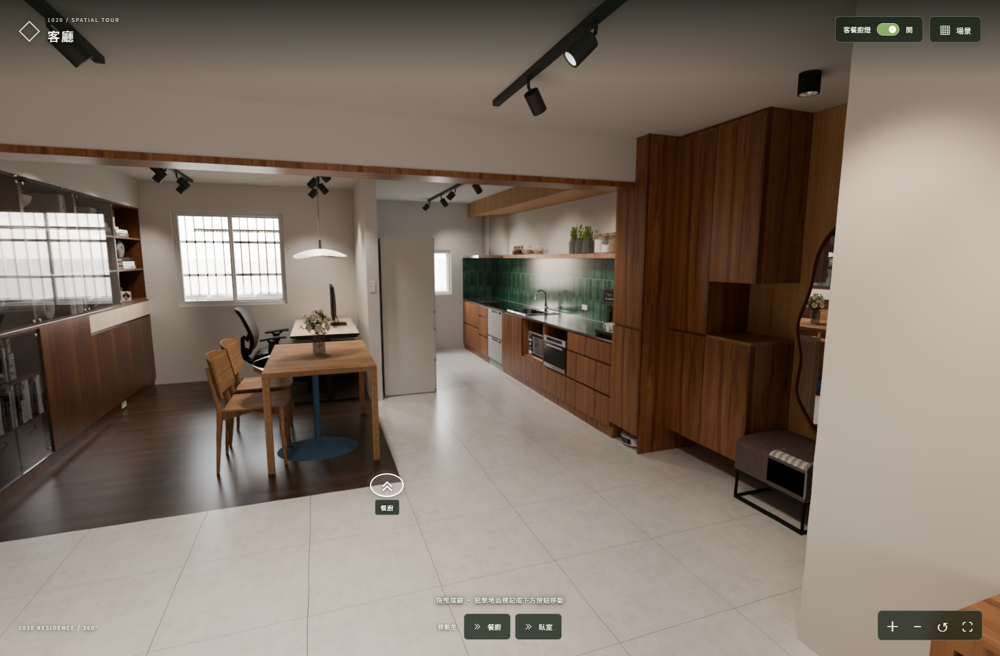

# Roomweaver Studio

本機室內平面核對、空間編輯與 Blender Cycles 出圖工作室。介面為繁體中文，透過瀏覽器操作；原始檔、模型修訂及渲染成果保存在自己的電腦。

目前有兩條主要路線：

| 你的輸入 | 首頁入口 | 後續流程 |
|---|---|---|
| PNG／JPG 平面圖 | 從圖片建立 | Agent 判讀 → 核對平面與尺寸 → 建立 3D → 編輯 → 整合輸出 |
| DWG／DXF 電子平面 | 從電子平面建立 | CAD 來源核對與判讀 → 確認單位、用途與高度 → 建立 3D → 編輯 → 整合輸出 |
| GLB／SKP 完整模型 | 完整 3D 直接出圖／網站 | 本機準備模型 → 原模型出圖／網站 → 預覽或下載網站 ZIP |

完整 3D 入口會直接進入「原模型出圖／網站」。平面圖建立的模型則進入「02 編輯」，接續「03 整合輸出」。

**早期開發版。** 主要驗證環境為 Windows、Python 3.11、Node.js 24 與 Blender 4.5 LTS；其他作業系統尚未完成同等端到端驗證。圖片與 CAD 的 AI 判讀需要 Codex；模型轉檔與基本渲染在本機執行。


上圖是隨附教學素材的渲染成果，使用有授權的共用家具與貼圖；不是目前介面的截圖。素材來源見 [範例手冊](examples/README.md)。

## 新版介面實拍

以下畫面於 2026-10-29 使用獨立展示工作區拍攝。首頁、匯入、平面核對與教學公寓網站使用 repo 內公開教學素材；02 編輯頁另使用經使用者授權展示的 1020.skp 參考模型副本。只公開截圖，不分發 1020 原始檔或案件紀錄；畫面中的待確認狀態保留原貌。

**我的專案**：建立新專案，或接續既有工作。



**三種匯入入口**：圖片、電子平面、完整 3D。



**核對平面**：公開 DXF 範例的原圖與物件／修正項／經驗庫。此畫面已確認毫米單位，尚未執行 Agent 判讀或採用設計。



**02 編輯｜參考模型展示**：使用 1020.skp 的獨立展示副本，呈現材質、門、裝飾物、光源及觀看點入口。此圖不是 Project09 的 DWG 判讀建模成果，也不表示 Project09 已完成核對、採用或驗收。原始模型與案件資料不隨截圖公開。



**02 編輯｜即時 3D 畫面**：同一獨立參考模型在「觀看點」頁的即時 3D 預覽；材質與光影顯示不等同 Cycles 渲染，亦不表示 Project09 已完成核對。



**原模型出圖／網站**：公開模型完成實際 Cycles 渲染後，可預覽與下載展示網站。



**360° 展示網站**：公開教學模型的實際渲染，以範例附帶的觀看點生成。



**1020 已部署的 360° 渲染展示**：以下為使用者指定之[線上展示網站](https://spatial-1020-gallery.pages.dev/?scene=living-day-on&mode=360)實拍，場景為客廳日景開燈。這是既有部署成果，與上方編輯器的即時預覽不同；本次只加入網站截圖及連結，不上傳網站素材包、模型或案件紀錄。



截圖來源與重拍方式見 [圖片說明](docs/images/README.md)。

## 從目前介面開始

### 我的專案

啟動後先進入「我的專案」。按「＋新建專案」，選擇空白資料夾並確認名稱，再選擇匯入方式。已有專案可從卡片繼續上次工作；不用停止服務或透過命令列另建專案。

應用 workspace 管理專案登記與工作佇列，專案資料夾保存各案內容。重新開啟既有工作時，必須使用原本的 workspace。程式目錄與案件目錄可以分開；完整備份需保留兩者中的執行資料與專案資料。

### 平面圖：01 匯入 → 02 編輯 → 03 整合輸出

1. 在「01 匯入」選「從圖片建立」或「從電子平面建立」，選取自己的檔案；也可點卡片內的「開啟範例」。
2. 設定 Agent 並執行判讀，在「核對平面」對照原圖、用途圖層與檢查結果。圖片需確認比例尺，CAD 需確認圖面單位；高度與未明尺寸仍需補充。
3. 處理 Q 疑點與 M 修正項，可在圖上標註並交由 Agent 局部修正。完成任務不等於通過檢查；未解問題仍會阻擋採用。確認平面與交接後建立基本 3D。
4. 在「02 編輯」切換「材質、門、裝飾物、光源、觀看點」。使用 2D／3D 畫布及共用工具列操作，保存修改；「查看未完成項目」可定位配置失敗或待處理的物件。
5. 設定光源、觀看點與效果圖方向，確認編輯後進入「03 整合輸出」。先選低解析預覽，按「建立出圖工作」，核對內容後按「確認並開始渲染」。
6. 檢查實際成圖，再選正式尺寸。寫實化精修與整屋試圖複核為選用功能；修正結果須比較、採用並重新確認後才作正式輸出。

核對頁支援原圖定位、用途圖層、已確認尺寸追溯與局部修正；CAD 可選本機物件模型輔助。完整操作見 [平面核對](docs/PLAN_REVIEW.md)、[CAD 原生讀取](docs/DWG_READING.md)、[交接標準](docs/INTAKE_STANDARD.md)。

### 完整 3D：原模型出圖／網站

1. 選「完整 3D 直接出圖／網站」，匯入 GLB 或 SKP。SKP 需先安裝選用轉檔依賴；檔案上限 512 MB。
2. 本機準備與交接檢查完成後，進入「原模型出圖／網站」。原家具、材質與位置沿用，照明與鏡位獨立保存。
3. 在「原模型出圖設定」選擇曝光、出圖品質、最多觀看點與照明方式。可使用預覽補光或原模型光源；有相符燈具資料時可沿用已建立的燈具光源。
4. 按「生成效果圖與展示網站」。完成後可切換網站版本，按「預覽網站」、「另開網站」或「下載可部署網站 ZIP」。
5. 若已連結同來源且通過核對的製作交付，才會出現「同步最新 8K 交付」。這是沿用已有成圖，不是每個匯入模型都能直接生成 8K 製作成果。

網站是固定觀看點的 360° 展示，可切換效果圖；不是自由走動的即時 3D。下載 ZIP 後需另行部署至靜態網站主機，工具不自動公開發布。詳見 [原模型網站](docs/SOURCE_WEBSITE.md)及[製作成果同步](docs/SOURCE_WEBSITE_UPSTREAM.md)。

### Agent 工作與設定

主要工作區右上角「Agent」整合「工作／設定」。工作頁可查看階段、耗時、最近回報與失敗原因；設定頁管理模型與能力測試。面板可收合，不會因新工作自動展開。原模型網站頁另有自己的渲染進度。

Agent 完成、檢查通過與使用者採用是不同狀態。確認過的尺寸、原始來源與舊修訂保留；遇到缺資料時需處理提示，不能把進度完成當作設計已確認。

## 安裝需求

已有舊版環境時，更新後重新執行下方 Python 安裝及前端建置；配置檢查新增 `shapely==2.1.2`，由安裝命令自動安裝，不需額外 DB。

| 工具 | 版本／用途 |
| --- | --- |
| Git | Clone 原始碼 |
| Python | 建議 **3.11.x**；宣告接受 3.11–3.13，其他版本未完成同等驗證 |
| Node.js／npm | **24.x**，用於建置及前端測試；建置後不需 Node 常駐 |
| Blender | **4.5 LTS**，須能執行 Cycles |
| 瀏覽器 | 支援 WebGL 的近期桌面瀏覽器 |
| 磁碟 | 渲染所在磁碟至少 6 GiB 可用空間，並預留修訂及圖片空間 |

CPU 可以渲染；相容 NVIDIA GPU 會嘗試 OptiX，否則使用 CPU。大型模型的記憶體與時間取決於場景。本 repo 不附 Blender 安裝包。

## 從 clone 到啟動（Windows PowerShell）

命令都在 repo 根目錄執行。

```powershell
git clone https://github.com/DingHungD/roomweaver-studio.git
cd roomweaver-studio
py -3.11 -m venv .venv
.\.venv\Scripts\python.exe -m pip install -c requirements-lock.txt -e ".[dev]"
npm ci --prefix frontend
npm run build --prefix frontend
```

安裝 Blender 後，將以下路徑換成自己的 **blender.exe**；若已在 PATH 可省略環境變數。

```powershell
$env:INTERIOR_BLENDER = "C:\Program Files\Blender Foundation\Blender 4.5\blender.exe"
.\.venv\Scripts\roomweaver.exe doctor
.\.venv\Scripts\roomweaver.exe serve --workspace workspace
```

開啟 **http://127.0.0.1:8765/**，首先看到「我的專案」。按「＋新建專案」選一個空白資料夾，名稱預設為資料夾名稱，可自行修改；確認後才建立專案並進入「01 匯入」。三張卡片提供圖片、電子平面與完整 3D 的入口，卡片內另有「開啟範例」。圖片仍需明確啟動 Agent 辨識，平面建模與出圖也須確認。這些命令不需啟用 PowerShell 虛擬環境腳本。

`--workspace` 是應用的工作佇列、資料庫及專案登記位置；使用者選定的專案資料夾可以放在其他位置。輸入批次、設定、修訂與模型／渲染成果保存在該專案底下，不會因再次匯入而多建立一張專案卡片。完整備份需同時保留專案資料夾及應用 workspace。

資料夾選擇使用本機系統視窗，需要 Python Tcl/Tk 與桌面環境（本機驗證為 Tk 8.6）。Python 安裝未含 Tk 時需補裝；服務在無桌面的遠端環境中無法使用這個本機選擇器。選取及建立時都會拒絕非空資料夾，不覆蓋既有內容。

若只使用 `INTERIOR_BLENDER`，每次重新開終端須重新設定，或把 Blender 加入自己的 PATH。建議首次啟動時加上 `--blender "C:\Program Files\Blender Foundation\Blender 4.5\blender.exe"`（替換為實際路徑），例如 `python -m interior.workbench serve --workspace workspace --blender "C:\path\to\blender.exe"`。工具會存入該工作區的 `artifacts/workbench/local/runtime.json`，下次相同工作區啟動會自動讀取，不需重新匯入。優先順序為 `--blender`、環境變數、已存設定、PATH；機器路徑不放入案件設計或 GitHub。`doctor --workspace workspace` 可檢查相同設定。8765 被占用時改成 `serve --workspace workspace --port 8875`，開啟 http://127.0.0.1:8875/ 。不要同時用兩個服務開啟同一份 workspace。

素材配置找不到 Blender 時會在下載前失敗，整批暫停，不會逐一耗盡備選。修正路徑並重啟服務後，按「沿用候選重試配置」可使用既有候選重新建立工作；搜尋結果與失敗紀錄保留，不重新呼叫 Agent 搜尋。

`requirements-lock.txt` 是已測試環境的 **constraints**，用 `-c` 限制版本。基本安裝不會因此安裝全部選用 Agent 套件。

## 格式與選用依賴

| 功能 | 額外需求與說明 |
|---|---|
| GLB 出圖 | Blender；建議嵌入貼圖並確認尺度、法線及物件命名 |
| SKP 匯入 | `python -m pip install -c requirements-lock.txt -e ".[sketchup]"`；[轉檔與限制](docs/SKETCHUP_IMPORT.md) |
| DWG 匯入 | 本機 ODA File Converter 與 LibreDWG；[安裝與來源核對](docs/DWG_READING.md) |
| 圖片／CAD Agent 判讀 | 下方 Agent 依賴、Codex 登入及可用圖片模型 |
| YOLO 物件模型輔助 | 選用 recognition 依賴及自行配置的本機模型；[操作](docs/OBJECT_RECOGNITION.md) |
| 素材搜尋及替換 | [BlenderKit 配對與授權](docs/BLENDERKIT.md) |

PDF 請先轉成圖片；DWF 尚無直接入口。網格燈具不等於實際光源，GLB 預覽與 Cycles 光影也可能不同。

DWG 工具需自行安裝，不隨本 repo 分發。可用 `ODA_FILE_CONVERTER` 與 `LIBREDWG_DWGREAD` 指定執行檔，或依操作文件保存本機 runtime 設定。機器路徑不寫入案件設計或 GitHub。

## 範例與功能手冊

三張匯入卡片均有「開啟範例」，詳細素材及重建方式見 [examples/README.md](examples/README.md)。完整 3D 範例同樣走目前的直接出圖／網站路線；要練習 02 編輯，請從圖片或電子平面建立模型。

| 功能 | 說明 |
|---|---|
| 圖片與概念配置 | [通用收件](docs/GENERIC_INTAKE.md) |
| 平面疑點、局部修正與確認 | [平面核對](docs/PLAN_REVIEW.md) |
| 本機 CAD 修正經驗 | [經驗庫](docs/CAD_EXPERIENCE.md) |
| 門與開啟方向 | [門編輯](docs/DOOR_EDITOR.md) |
| 現有燈具建立光源 | [燈具照明](docs/FIXTURE_LIGHTING.md) |
| 未完成配置定位與修正 | [編輯修正](docs/EDITOR_REPAIR.md) |
| 寫實化與整屋試圖 | [寫實精修](docs/REALISM_REFINEMENT.md)／[整屋複核](docs/SCENE_REVIEW.md) |
| 大型模型操作 | [編輯效能](docs/EDITOR_PERFORMANCE.md) |
| 啟動與執行問題 | [疑難排解](docs/TROUBLESHOOTING.md) |

## 選用：Codex Agent

圖片與 CAD 的 Agent 判讀、素材配置及試圖複核需要此項；完整 3D 的基本出圖可不使用 Agent。安裝額外套件及瀏覽器：

```powershell
.\.venv\Scripts\python.exe -m pip install -c requirements-lock.txt -e ".[agent]"
.\.venv\Scripts\python.exe -m playwright install chromium
```

依 [官方 Codex CLI 說明](https://developers.openai.com/codex/cli) 安裝並登入自己的帳號，確認 CLI 提供 `app-server`。Windows 請把 `INTERIOR_CODEX` 指向原生 `codex.exe`，不要指向 npm 的 `.cmd` 包裝檔。例如 `$env:INTERIOR_CODEX = "C:\path\to\codex.exe"`，然後重啟服務。

點右上角「Agent」，切到「設定」，分別檢查連線、看圖、工具、瀏覽器操作。使用 [App Server stdio 協定](https://developers.openai.com/codex/app-server)，adapter 原先針對 CLI 0.154.0 撰寫；新版需再驗證。

未指定模型時，使用 Codex `model/list` 回傳的預設模型，明確傳入本次任務，不繼承其他工具寫入本機設定的模型名稱。模型清單不等於帳號權限驗證；一鍵配置會先執行一次短連線測試，再開始整批搜尋。拒絕的模型不會逐件重試、下載或改用付費 API；請重新檢查模型、測試連線後建立新配置，舊記錄保留。2026-10-12 已以 CLI 0.154.0／ChatGPT 登入實測 `gpt-6-astra` 文字連線成功；此項不代表其他帳號或工具／判圖測試通過。

Codex 使用雲端模型與帳號額度，不是完全離線推論。啟用判圖會傳送試圖及任務所需資訊。憑證由 Codex 管理，不寫入 repo。失敗不自動切換其他付費供應者。Computer use 目前為專用 Playwright 瀏覽器與受控工具，不是控制整個 Windows 桌面。

## 開發、測試與打包

```powershell
.\.venv\Scripts\python.exe -m pytest -q
npm test --prefix frontend
npm run build --prefix frontend
.\.venv\Scripts\python.exe -m build --wheel
```

測試不呼叫雲端模型。真正 Blender 驗證需設定 `INTERIOR_BLENDER`：

```powershell
.\.venv\Scripts\python.exe tools/smoke_render.py --workspace artifacts/smoke-my-run
.\.venv\Scripts\python.exe -m pytest tests/integration/test_blender_checks.py -q
```

Smoke 目錄須尚未存在；它會上傳範例、確認修訂並產生四張真圖，保留證據。不呼叫 Agent。詳見 [驗證紀錄](docs/VALIDATION.md)。

開發時先啟動 8765 後端，再於另一終端執行 `npm run dev --prefix frontend`，開啟 http://127.0.0.1:5173/ 。一般啟動由 FastAPI 提供已建置頁面。

Wheel 包含 Python 核心、Blender 腳本與建置好的 UI；範例和開發文件留在 repo。**打包前必須建置前端。**

## 資料與發布邊界

- `frontend/`：介面與展示網站程式。
- `src/interior/`：API、工作佇列、CAD 處理、Blender 建模與渲染。
- `examples/`、`tests/`：公開教學素材與合成測試。
- `docs/`、`tools/`：功能文件與維護工具。
- 應用 workspace：本機資料庫、設定與專案登記；專案可位於使用者選定的其他資料夾。
- 專案的 `sources/`、`workflows/`、`runs/`：原件、設定／修訂、模型與成果。

私人案件、workspace、執行產物、憑證及模型權重不提交 GitHub。「備份設定」不能取代完整專案與素材備份。原始檔與舊修訂保留，重新匯入不直接覆寫原件。

此服務供本機單使用者操作，預設綁定 loopback；沒有公開多人服務所需的帳號與隔離機制。展示網站 ZIP 可另行發布，與公開後端服務是不同用途。

## 授權與參與

程式與原創場景組合採 [MIT](LICENSE)；日光公寓中的第三方資產保留 CC0-1.0。第三方套件各自保留授權，見 [THIRD_PARTY_NOTICES.md](THIRD_PARTY_NOTICES.md)。匯入的私人模型及素材不會因此變成 MIT。

參與方式見 [CONTRIBUTING.md](CONTRIBUTING.md)，安全範圍見 [SECURITY.md](SECURITY.md)。勿提交客戶資料、憑證、workspace 或私人日誌。
