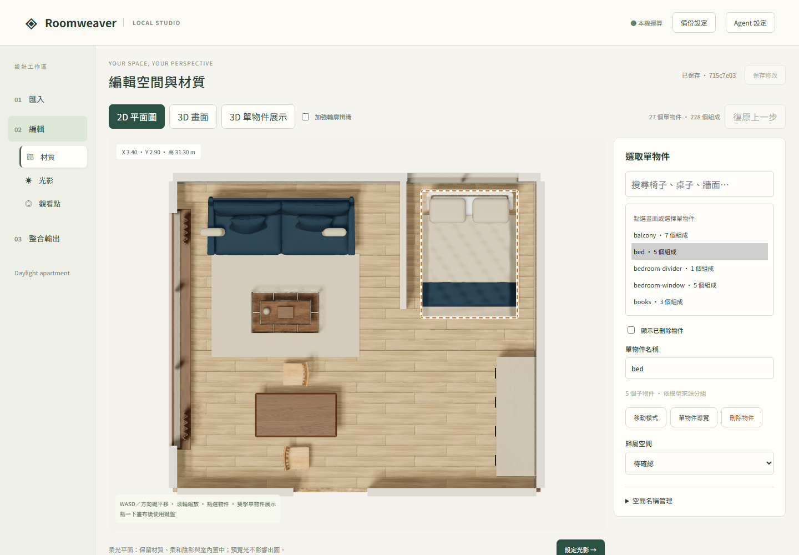

# Roomweaver Studio

新增功能：[通用手繪確認、答覆後修正與概念家具編輯](docs/GENERIC_INTAKE.md)。兩張獨立合成圖在 [hand-drawn-study](examples/hand-drawn-study/README.md)，可在 UI 內練習完整確認流程。

Local interior editing, lighting and Blender rendering — 本機室內模型編輯、光影配置與全景出圖工作室。

將 **PNG／JPG 判讀／GLB 匯入／DXF 平面確認與建模 → 編輯物件／材質／光影／觀看點 → Blender Cycles 出圖** 串成瀏覽器介面。檔案與渲染留在自己的電腦；GLB／DXF 的基本流程不需要 API key、Codex 或模型訂閱；圖片辨識則需要本機 Codex 的圖片模型。

**早期開發版，介面為繁體中文。** 完整驗證環境：Windows、Python 3.11.9、Node.js 24.19.0、Blender 4.5.14 LTS。其他作業系統尚未完成端到端驗證。


上圖使用隨附日光公寓、BlenderKit 免費 CC0 家具與貼圖，經 Cycles 實際渲染。窗外為示意城市環境，非基地照片。完整光影用 native Blender／GLB 配對重現；單獨 GLB 不保留 HDRI world。

## 功能與格式

- 匯入 GLB，保留原件，建立工作副本。
- 在 2D 平面或 3D 選取整組家具；單物件展示可選子物件，修改基本色、粗糙度及材質需求。
- 平移／水平旋轉／刪除家具、配置或綁定光源、預覽近似光影。
- 02 編輯分為「材質、裝飾物、光源、觀看點」。材質／裝飾物頁可在 2D 框選新增範圍，輸入需求搜尋模型或貼上 BlenderKit 模型頁網址，核對後下載替換；新增物件可移動、旋轉與刪除。
- 在 3D 單物件展示請 Agent [配對 BlenderKit 家具與材質](docs/BLENDERKIT.md)：免費優先、付費候補；保留來源網址，選定後在工具內下載並替換。
- 在「光源」預覽並配置室外日光、天花燈具及綁定光源；在「裝飾物」的自動建議中安排桌面用品、花瓶、鍋具與地毯，再由 Agent 找免費 BlenderKit 模型。位置依模型範圍與用途規則推算，需在 2D／3D 核對；不是自動完成室內設計驗收。
- 「一鍵配置」可按整屋、空間或家具類型批次配對；支援共用／個別文字與圖片風格。自動下載免費候選並建立第一版，備選保留連結；全部家具確認後才清理未使用模型。
- 拖曳觀看點、設定多個效果圖方向與雙向連結。
- 確認後產生 2:1 全景及透視效果圖，保存修訂、工作日誌及舊成果。
- 選用 Codex App Server 執行材質候選、試圖判讀及受控瀏覽器能力測試。
- 平面確認頁新增選用 **AI 空間配置**：依生活需求提出家具與動線，經幾何檢查及人工採用後建模。

| 輸入／功能 | 本版狀態 |
| --- | --- |
| `.glb` | 可直接匯入；建議嵌入貼圖、清楚命名物件，以公尺校核尺寸 |
| `.png`／`.jpg`／`.jpeg` | 新增「從圖片建立」：Codex 判讀 → 比例尺與平面人工確認 → 概念 3D；需要圖片模型與本機 Codex ChatGPT 登入 |
| `.dxf`（2D） | 新增「從電子平面建立」：確認單位、用途與高度後建模；支援範圍見下方 |
| `.dwg`／`.dwf`／`.skp` | 尚未提供直接入口；先用支援該格式的建模軟體整理並匯出受支援 DXF 或 GLB |
| 燈具模型 | 網格外觀不等於光源，需另有實際光源資料或在光源頁新增 |
| 材質連結 | 保存參考網址與描述；候選採用目前修改基本色與粗糙度，不是完整 PBR 下載器 |
| 觀看點連結 | 保存導覽關係；尚未產生移動影片或完整公開導覽網站 |
| Claude／Ollama | 尚未實作 adapter |

## 安裝需求

已有舊版環境時，更新後重新執行下方 Python 安裝及前端建置；配置檢查新增 `shapely==2.1.2`，由安裝命令自動安裝，不需額外 DB。

| 工具 | 版本／用途 |
| --- | --- |
| Git | Clone 原始碼 |
| Python | 建議 **3.11.x**；宣告接受 3.11–3.13，其他版本未完成同等驗證 |
| Node.js／npm | **24.x**，用於建置及前端測試；建置後不需 Node 常駐 |
| Blender | **4.5 LTS**，須能執行 Cycles |
| 瀏覽器 | 支援 WebGL 的近期桌面瀏覽器 |
| 磁碟 | 渲染所在磁碟至少 6 GiB 可用空間，並預留修訂及圖片空間 |

CPU 可以渲染；相容 NVIDIA GPU 會嘗試 OptiX，否則使用 CPU。大型模型的記憶體與時間取決於場景。本 repo 不附 Blender 安裝包。

## 從 clone 到啟動（Windows PowerShell）

命令都在 repo 根目錄執行。

```powershell
git clone https://github.com/DingHungD/roomweaver-studio.git
cd roomweaver-studio
py -3.11 -m venv .venv
.\.venv\Scripts\python.exe -m pip install -c requirements-lock.txt -e ".[dev]"
npm ci --prefix frontend
npm run build --prefix frontend
```

安裝 Blender 後，將以下路徑換成自己的 **blender.exe**；若已在 PATH 可省略環境變數。

```powershell
$env:INTERIOR_BLENDER = "C:\Program Files\Blender Foundation\Blender 4.5\blender.exe"
.\.venv\Scripts\roomweaver.exe example --workspace workspace
.\.venv\Scripts\roomweaver.exe doctor
.\.venv\Scripts\roomweaver.exe serve --workspace workspace
```

開啟 **http://127.0.0.1:8765/**。`example` 登記完整日光公寓；到匯入頁選 DAYLIGHT 並點「使用案件現行模型」。它不自動確認設計或出圖。若只想建立空案件，改用 `init`。這些命令不需啟用 PowerShell 虛擬環境腳本。

每次重新開終端須重新設定 `INTERIOR_BLENDER`，或把 Blender 加入自己的 PATH。下次啟動只需設定路徑再執行 `serve`，不需重裝或重新匯入。8765 被占用時改成 `serve --workspace workspace --port 8875`，開啟 http://127.0.0.1:8875/ 。不要同時用兩個服務開啟同一份 workspace。

`requirements-lock.txt` 是已測試環境的 **constraints**，用 `-c` 限制版本。基本安裝不會因此安裝全部選用 Agent 套件。

## 第一次操作：日光公寓

[完整範例與資產來源](examples/daylight-apartment/README.md)包含免費 CC0 沙發、茶几、兩張木椅與床，以及木紋、布料、灰泥貼圖和城市 HDRI。另有窗簾褶皺、棉被垂邊、枕頭、櫃門接縫與陽台近景幾何。

1. **匯入**：選擇 Daylight apartment · DAYLIGHT，點「使用案件現行模型」。這會建立原生 `.blend`／GLB 工作副本，保留 HDRI、面光與材質。
2. **材質**：選沙發或椅子，雙擊進入單物件展示以檢視子物件。首次重現範例請保留原材質：目前「基本色」指派會替換該子物件的材質，包含原貼圖；不是保留 PBR 通道的調色器。
3. **光源**：可直接保留現有日光。要微調時點「自動配置照明」，取得現有光源，保存後用 3D 光影預覽檢查。第一次不要啟用 Codex 判圖。
4. **觀看點**：已附 Living、Bedroom，各有一個 32 mm 方向及雙向連結。可拖曳位置、修改方向，再用「3D 預覽」檢查。
5. **確認**：點「確認編輯，前往整合輸出」。
6. **出圖**：先選低解析，點「建立出圖工作」，核對 **2 張全景＋2 張效果圖**，再點「確認並開始渲染」。人工檢視後才提交正式尺寸。

預覽為 1024×512 全景、640×480 效果圖；正式為 4096×2048 全景、1600×1200 效果圖。README 示意圖是範例腳本的 1440×1080、96 samples Cycles 出圖。改動後須保存並重新確認，舊成果會標示舊修訂。

2D 用方向鍵／WASD 平移、滾輪縮放；3D 用 W/S 前後、A/D 水平側移、空白鍵／Shift 升降。雙擊物件進入單物件展示、拖曳旋轉；操作時先將焦點放在畫布。

2D 預設為 **B 柔光平面**：保留地板／家具貼圖、法線及粗糙度，使用獨立柔光、固定曝光與柔化陰影，並補上可辨識牆體的水平切面。原 GLB 的高強度日光不會疊加到編輯畫面。「加強輪廓辨識」可切回簡化地板與邊線，方便選取。

平面柔光是即時 WebGL 近似效果，與 Blender 提案圖的完整間接光仍有差異；不修改案件燈光、原材質或正式出圖。一般 3D 編輯使用獨立補光，光影頁則依已採用的燈光設定預覽。



平面取景會優先依可辨識的室內地板範圍置中，排除窗外佈景、陽台及切面上方物件；切回 3D 會恢復顯示。自動範圍目前依 `floor`／地板／地坪與室外物件命名判斷；未找到地板時退回其餘可見模型範圍，不宣稱能辨識任意未命名模型的室內輪廓。

也可直接上傳 [daylight-apartment.glb](examples/daylight-apartment/daylight-apartment.glb)，但 GLB 僅使用窗外近似燈光，不能重現完整 HDRI。要得到上圖的光影，請用上述配對入口。

保留的 [輕量範例](examples/demo-apartment/README.md)僅作安裝與自動測試 fixture，適合很快測試 GLB 上傳，不是品質展示。

## 使用自己的檔案

### 從 DXF 建立 3D（本機新增功能）

更新後重新安裝 Python 依賴並建置前端（沿用上方安裝命令）；新增依賴為 `ezdxf`，不需 Agent 帳號。

1. 建立或選擇案件 →「01 匯入」→「從電子平面建立」→ 上傳 `.dxf`。
2. 在平面確認頁核對單位、範圍及每個元件用途；可改名稱、高度、離地高度、中心線牆厚與 X/Y 平移。圖層名稱只提供建議，不代表已確認。
3. 按「保存並檢查平面」，修正阻擋項目，勾選範圍確認，再按「確認平面，建立 3D」。
4. 完成 GLB／BLEND 交接檢查後自動進入編輯。新增觀看點、確認光影，再進入整合輸出。

可直接上傳 [courtyard.dxf](examples/dxf-courtyard/courtyard.dxf)，按 [範例手冊](examples/dxf-courtyard/README.md)測試。這是 7 × 6 m 的合成概念模型，用於驗證匯入流程，家具為占位而非精細家具資產。

支援 **ASCII DXF、模型空間、世界 XY 平面、LINE／無圓弧的 LWPOLYLINE**。牆可以是中心線或封閉凸輪廓；地板／家具為封閉凸輪廓；門窗以沿牆直線表達寬度。門窗會實際切出洞口，窗附簡易框；不建立門扇、天花或自動房間分區。提供可調整的初始照明。

上限 10 MB、2,000 個模型空間元件、每元件 100 頂點、合計 20,000 頂點。TEXT／MTEXT／DIMENSION 明示略過；INSERT、圓弧、非零高程、凹輪廓及其他未支援內容會阻擋建模。請先在 CAD 展開圖塊、整理輪廓，不會將錯誤原件替換成範例。DXF 原始座標保留，生成模型以地板範圍移近原點，偏移記錄在 `plan-build.json`。

平面設定保存在 `workflows/plan-import/` 的不可變修訂；重新開啟同案入口可續編。相同確認版本重送只建立一個工作；要修正或重試，先保存新修訂。原 DXF、舊修訂與模型不覆寫。PNG／JPG、DWG 與 SKP 的原生入口仍未開放。

### 從 GLB 開始

先停止服務（Ctrl+C），建立另一案件，再用同一 workspace 啟動：

```powershell
.\.venv\Scripts\roomweaver.exe new-project MY_HOME --name "My home" --workspace workspace
.\.venv\Scripts\roomweaver.exe serve --workspace workspace
```

在案件選單選新案件，匯入自己的 GLB。ID 使用英數、底線或連字號，顯示名稱可以不同。

先在建模軟體確認尺寸、法線、牆厚、家具名稱及貼圖。名稱／階層與幾何只是分組線索，匯入後仍應檢查；房間不保證能從任意網格自動準確辨認。建議物件名稱清楚且不重複。

原件複製到案件 `sources/`；Blender 工作模型與成果寫入 `runs/`；修改採不可變修訂，不回寫你選取的原始 GLB。大小限制見 [疑難排解](docs/TROUBLESHOOTING.md)。

## 選用：Codex Agent

完成基本流程後才需要此項。安裝額外套件及瀏覽器：

```powershell
.\.venv\Scripts\python.exe -m pip install -c requirements-lock.txt -e ".[agent]"
.\.venv\Scripts\python.exe -m playwright install chromium
```

依 [官方 Codex CLI 說明](https://developers.openai.com/codex/cli) 安裝並登入自己的帳號，確認 CLI 提供 `app-server`。Windows 請把 `INTERIOR_CODEX` 指向原生 `codex.exe`，不要指向 npm 的 `.cmd` 包裝檔。例如 `$env:INTERIOR_CODEX = "C:\path\to\codex.exe"`，然後重啟服務。

UI 開啟「Agent 與能力測試」，分別檢查連線、看圖、工具、瀏覽器操作。使用 [App Server stdio 協定](https://developers.openai.com/codex/app-server)，adapter 原先針對 CLI 0.154.0 撰寫；新版需再驗證。**本次獨立版尚未執行真實訂閱／模型測試。**

Codex 使用雲端模型與帳號額度，不是完全離線推論。啟用判圖會傳送試圖及任務所需資訊。憑證由 Codex 管理，不寫入 repo。失敗不自動切換其他付費供應者。Computer use 目前為專用 Playwright 瀏覽器與受控工具，不是控制整個 Windows 桌面。

## 開發、測試與打包

```powershell
.\.venv\Scripts\python.exe -m pytest -q
npm test --prefix frontend
npm run build --prefix frontend
.\.venv\Scripts\python.exe -m build --wheel
```

測試不呼叫雲端模型。真正 Blender 驗證需設定 `INTERIOR_BLENDER`：

```powershell
.\.venv\Scripts\python.exe tools/smoke_render.py --workspace artifacts/smoke-my-run
.\.venv\Scripts\python.exe -m pytest tests/integration/test_blender_checks.py -q
```

Smoke 目錄須尚未存在；它會上傳範例、確認修訂並產生四張真圖，保留證據。不呼叫 Agent。詳見 [驗證紀錄](docs/VALIDATION.md)。

開發時先啟動 8765 後端，再於另一終端執行 `npm run dev --prefix frontend`，開啟 http://127.0.0.1:5173/ 。一般啟動由 FastAPI 提供已建置頁面。

Wheel 包含 Python 核心、Blender 腳本與建置好的 UI；範例和開發文件留在 repo。**打包前必須建置前端。**

## 檔案與資料管理

```text
frontend/                         React + TypeScript + Three.js
src/interior/workbench/            API、案件、工作佇列
  studio/                         場景、修訂、材質、燈光、觀看點
  orchestration/                  LangGraph 確認／續跑
  agent_runtime/                  Codex 與受控工具（選用）
src/interior/visualization/        Blender／Cycles 與畫面檢查
examples/daylight-apartment/       CC0 家具／貼圖、GLB/native 配對、渲染圖
examples/demo-apartment/           最小測試 fixture
tests/                            單元、契約及合成 Blender 測試
tools/                            開發者驗證工具
docs/                             架構、驗證、疑難排解
workspace/                        執行後建立；私人資料，不進 Git
```

`workspace/artifacts/workbench/local/jobs.sqlite3` 管工作與事件；`agent-checkpoints.sqlite3` 管 LangGraph 狀態。案件設定、原件與大檔案在 `workspace/projects/<id>/`。使用 SQLite，不需另架 DB 服務；備份與恢復見 [架構文件](docs/ARCHITECTURE.md)。

本版為本機單使用者，僅綁定 loopback，尚無公開部署的帳號與隔離機制。架構改進見 [架構評估](docs/ARCHITECTURE.md#下一階段優化)。

## 授權與參與

程式與原創場景組合採 [MIT](LICENSE)；日光公寓中的第三方資產保留 CC0-1.0。第三方套件各自保留授權，見 [THIRD_PARTY_NOTICES.md](THIRD_PARTY_NOTICES.md)。匯入的私人模型及素材不會因此變成 MIT。

參與方式見 [CONTRIBUTING.md](CONTRIBUTING.md)，安全範圍見 [SECURITY.md](SECURITY.md)。勿提交客戶資料、憑證、workspace 或私人日誌。

## 圖片 → 平面確認 → 3D（本機開發版）

1. 在「匯入」選擇案件，再按「從圖片建立」，上傳完整 PNG／JPG。上限 20 MB、2,400 萬像素，最小邊 100 像素；PDF 請先匯出成圖片。
2. 按「連接本機 Codex」，選擇實際可用的圖片模型。可補充尺寸單位、符號意思、圖面已知疑點。
3. 按「請 Agent 辨識」才會將**該張圖片與補充說明**送至 Codex 雲端模型，使用自己的訂閱額度。單純上傳不會呼叫模型；不會改用其他付費 API。
4. 辨識完成後按「核對平面」。原圖與向量輪廓疊合顯示；在原圖點兩個已知長度的端點，輸入公尺並確認比例尺。Agent 建議尺度也必須人工核對。
5. 點選元件後可改用途、名稱、高度、宿主牆與平移；拖曳白色頂點或輸入像素座標可修正線稿。漏辨時使用「補上漏辨元件」，誤辨時將用途改成「略過」。門窗可明確選定牆後按「將洞口對齊選定牆線」。
6. 逐項處理辨識疑點，保存檢查；通過後勾選建模範圍，再按「確認平面，建立 3D」。完成共同交接檢查後自動進入原有編輯流程。

**能力邊界：**這是可校正的概念轉錄，不是自動精準測繪。全圖比例尺不會修正手繪的局部變形；要精準尺寸需再整理 CAD。僅建立直牆、凸多邊形地板／家具占位及門窗洞口；不會生成精緻家具、天花、梁柱完整施工模型或自動完成空間分區。模型漏辨、疑點、宿主錯位都可能需要人工修正。

圖片正規化會處理 EXIF 方向、白底合成透明區與縮小到最長邊 2048；原件保持不變。辨識失敗、停止或服務重啟不會自動付費重試；重新選擇圖片後才可再次提交。保存後可重新開啟同一案件續編；修改平面會產生新修訂，舊模型保留。

設定與辨識證據在案件 `workflows/plan-import/`，原件在 `sources/workbench/`，模型在 `runs/interior-studio/`。平面目前以可編輯修訂 JSON 保存，尚未提供轉錄 DXF 下載。Project03 的私人測試圖不包含在公開範例中。

### 圖片辨識的複核與自動修正（本機開發版）

按「請 Agent 辨識」會執行兩輪：整圖盤點、四個重疊放大區域複核。第二輪同時收到第一輪的幾何檢查，補辨牆、門窗、設備並整理量測端點；使用同一個已選 Codex 模型，不會換供應者。通常比單輪花更多時間與訂閱額度，可停止，服務重啟不自動重送。

確認頁分為原圖疊合、自動處理紀錄、尺寸端點表、需要回答的問題。中等信心不再逐件產生確認框；明確語意疑點、低信心重要元件、無法安全對齊的洞口仍保留。洞口只在已指定的唯一牆段且偏差不超過 `min(8 px, 短邊 × 0.008)` 時自動投影，保留前後座標；不延長牆、不猜宿主、不改寫原稿。

清楚長尺寸可預填候選比例尺，仍須確認。尺寸表保存辨識當時的像素比例差額；不代表實測幾何，也不會因修改比例尺而覆寫歷史。全圖比例不一致時保留差異，不自動扭曲手稿、推算標準門寬或聲稱施工尺寸通過。每張圖的顏色、單位與量測習慣需在補充說明提供，不套用範例作者的習慣。

既有草稿及修訂不會被新辨識覆寫。要試新版，重新選擇同一張圖片，產生獨立收件及辨識紀錄；最終建模仍需使用者確認。


### 沿用本案既有確認（本機開發版）

確認頁會顯示「已沿用本案確認紀錄」、已解決／部分已確認的答案與來源。已有明確答案的題目不再要求重複勾選；部分已確認的題目只保留未知端面或用途。尺寸表同時顯示原誤讀與採用值，不把已確認數值誤稱為影像辨識成功。

本版由維護者把同一案件的確認紀錄對應至該版疑點／尺寸 ID，再透過 `/image-plans/{image_id}/refine` 提交。尚無自動搜尋任意資料夾或匯入確認文件的使用者介面；不會掃描其他案件套用答案。補充紀錄及圖片會送至指定 Codex 模型，使用訂閱額度。來源文字、來源雜湊及對應範圍保存在新收件中，原稿及舊修訂不變。

疑似數字誤讀可指定原圖文字區域，以放大原向及兩個旋轉方向獨立讀圖，再比對歷史確認。不清楚時保留候選；確定的歷史量測優先，但不猜量測端面、不全圖拉伸。比例尺與最終建模仍需確認。接口與限制見 [架構文件](docs/ARCHITECTURE.md#image-evidence-refinement-v3)。


### 直角重建與圖上答覆（本機開發版）

手繪線用來辨認構件及相對位置，不能把筆跡傾斜直接當成斜牆。已確認的尺寸與量測端面優先；遇到不閉合要保留差異，不能分攤誤差假裝全部滿足。

已知本案為直角格局時，先保存，再按「本案牆角為90°，整理線條」。系統另存校正版，整理牆體水平／垂直、保持共用頂點，門窗沿原宿主同步調整。接近斜向而無法判斷的牆會拒絕自動校正。原圖片及原始轉錄點不變，可疊合比較。

目前校正頁會明示「已綁定尺寸幾筆」。尺寸須先有來源紀錄及兩端構件頂點／方向對應，才能透過校正 API 作精確長度約束；此版尚無滑鼠綁定量測端面的操作介面，也不會自動把文字框當端點。零筆代表僅做角度整理，尚未將各段長度重建為精確實測值。互相矛盾的已綁定尺寸會拒絕套用，修改幾何後也會重新檢查既有約束。

有圖上說明的案件會顯示編號彩框、局部原圖、已知內容、待答事項及回答欄。可轉正檢視、逐題放大，圖內滾輪不捲動頁面。回答隨「保存並檢查平面」保存，尚不自動等同設計確認。也可依編號在聊天一次答覆，讓Agent對照同版標記處理。


### 精確尺寸、A→B 標記與建模阻擋原因（本機開發版）

確認尺寸表分為「已套用」「幾何衝突」「端點未明／未綁定」，並可定位到平面上的綠色尺寸線。修改尚未保存時標為待重新檢查，保存後依當前幾何重新計算。歷史條件算式的差異單獨附來源，不冒稱為這版模型的實測差額。端點不明的尺寸保留原值，不能用全圖縮放或平均分配誤差消除矛盾。

API 的 `opening_width` 綁定可將已確認門窗寬度套用至同一開口兩端；保持宿主牆幾何，位置在既有連續直牆上最小平移以容納寬度，並明示位置仍為提案。超過可用牆長則拒絕，不能延長牆或縮小確認值。一般頂點尺寸仍使用 `vertices` 模式；本版不會從數字文字框猜測幾何端面，量測綁定目前由有證據的服務端操作建立。

在原圖按「畫 A→B，說明端點」，依序點兩點，再輸入內／外牆面、門框、數字與單位等說明，可選擇對應問題。支持旋轉、縮放及刪除標記，保存後可重開。這是保存在修訂 JSON 的使用者證據，不會自動當作比例尺、精確尺寸綁定或已解決問題；尚需後續核對。

「建立 3D」前會列出未保存、比例尺、未確認問題、平面檢查及最後確認的阻擋原因；可按「前往處理」。幾何錯誤旁可定位元件，例如新增門洞尚未指定唯一宿主牆。修改後先保存檢查，通過後才開放最終確認，不會偷偷略過錯誤建模。


## AI 空間配置（本機新增）

入口放在 **01 匯入 → PNG/JPG 或 DXF 的平面確認 → AI 空間配置：家具與動線**。先確認尺度與固定構件，再做功能與家具配置，最後才建立 3D。02 編輯繼續負責材質、光影與觀看點；一般 GLB 未有可靠平面語意，這版不對任意 GLB 自動重排。

1. 匯入後依「核對平面 → AI 空間配置 → 建立 3D」分段操作。已确认的尺度、答覆與辨識紀錄預設收合，需要時可再展開。保存平面並處理檢查錯誤後，點選第二段。
2. 填寫生活需求、逐項必要條件及主要通道寬度。若維護者已匯入本案需求包，會自動帶入並提供來源查閱；平面上的既有答覆一併交給 Agent，不重問已回答事項。既有家具預設不動，需移動的才勾選授權；固定牆、門窗、地板不可變動。
3. 連接本機 Codex，選擇帳號實際可用的模型，再請 Agent 提案。需求與平面座標會送到 Codex；需要 ChatGPT 登入及訂閱額度，最多一輪提案及兩輪修正。
4. 預覽藍色新增／移動家具、橘色操作區、綠色或紅色動線。閱讀逐項需求承接、設計理由、假設與未解事項。
5. 通過程式檢查後，明確接受候選並按「採用配置，另存平面」。重新確認建模，再建立 GLB／BLEND，进入 02 編輯。未採用前原平面不變；提案過期時必須重新提出。

若無法開始，介面會列出未保存修改、平面問題、需求空白、模型未選或需求包過期等原因，可按「前往處理」。無需先勾選第三段的建立 3D 確認，就能提出配置。

檢查包括家具碰撞、室內範圍、牆體、門洞保留帶、通道完整寬度與家具操作區。Agent 修正會收到實測重疊範圍；既有窄門及不連續地板另列為平面限制，不會自動改圖。這些檢查不等於住宅功能、門扇開啟、施工、採購或法規全數通過。Agent 必須列出未解需求，不可用通過幾何檢查掩蓋未知。家具目前包含床、上下舖、沙發、餐桌、書桌、椅子、櫃子、爐具、洗衣機與電視的通用概念模型，尚未接商品庫或自動下載材質。

測試用 [6 × 6 m 工作室範例](examples/layout-study/README.md) 可直接匯入，沒有客戶資料。若已建立 3D 後回到平面重做配置，會建立新的模型基線；既有模型修訂保留，但材質／燈光等後續修改不會自動合併到新模型。

接續修正會保留上一版家具ID、尺寸、需求承接與生活路線，不能透過刪件／縮小換取通過。桌椅採「座位占用」與「淨空操作」分別核對。維護端可另存Agent輔助修正預覽；它與模型執行成功不同，預覽不能直接採用。
