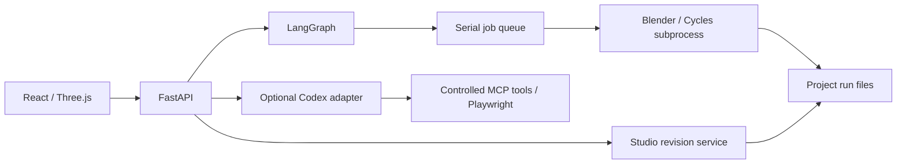

# 架構與開源抽離範圍

## Generic intake and concept furniture（2026-10-12，本機）

- `GET/PUT image-plans/{id}/feedback` 保存不可變確認紀錄，綁定 `base_revision`／`base_feedback_id`。UI 輸入來源、原文、疑點範圍及數值確認，無案件腳本依賴。
- `refine` 傳入已保存的幾何、確認紀錄與既有證據背景。補丁按引用範圍驗證；已確認數值不可自行改寫，缺漏新增只能在明確回答的 missing 區域內，開口可依已引用宿主建立。最多兩次補丁回應，失敗不套用。`retry_of` 只允許明確重試同版失敗／停止任務；去重包含此識別碼。
- `image_review.question_notes` 依 Agent 像素框或來源元件產生問題標註；無位置則標示全圖且明說未知。問題 ID／數量與內容依每次輸入，配置提案以 `question_targets` 引用來源元件；無 Project03 特例。
- 修正另存 child intake；開啟前再次核對父修訂，保留高度、已確認尺度、尺寸約束、A→B 與歷次確認，不在讀取時修改原件。
- 家具區域採用分開 `hard_errors` 與待微調動線／操作區。放寬後者須明確 `accept_layout_limits`，以 `layout_adoption` 保存需求、覆蓋與未解事項，交接為 Scene `design_notes`；不改固定基線或允許推導地板冒充已確認。
- `GET/POST concept-furniture` 提供十類概念家具及標準幾何；無副作用。修訂 `concept_furniture` 保存類型、尺寸、穩定 ID 與由服務驗證的部件。Scene.objects/groups 必須完整包含原模型及新增部件，不接受任意網格或程式。
- `visualization/concept_geometry.py` 是共用目錄及部件權威。Three.js 依標準部件顯示，Blender 在工作副本建立相同尺寸部件，再套位移／軟刪除／子物件材質。復原可移除新增項，原始 GLB／BLEND 保持不變。

所有者：系統開發。正式入口是根 README，本目錄不保存案件資料。程式從既有本機工作台抽離；本 repo 為可獨立維護的快照，更新須明確合併，不會同步覆寫原工作台。

## 執行責任



LangGraph 保存確認與渲染續跑狀態，序列佇列執行重型工作。Agent 任務使用專用目錄與受控工具，幾何匯入、版本檢查和渲染由確定性程式處理。

本次已拆除舊 CAD 介面、API 與啟動依賴，新增獨立 CLI、案件初始化及可攜 Blender 路徑。前端不再依賴相鄰 plan_editor 套件，移除既有案件預設 ID。為保留 subprocess 與工作資料相容性，Python **內部模組仍稱 `interior`**，外部發行及 CLI 為 `roomweaver-studio`、`roomweaver`。請用獨立虛擬環境，勿和原工作台共裝。

## 資料權威

```text
workspace/
  projects/<id>/
    project.json, README.md
    sources/                       原始上傳副本
    workflows/interior-studio/      現行指標、不可變修訂、設計確認
    workflows/plan-import/          DXF 判讀、不可變平面修訂與現行指標
    runs/interior-studio/<job>/     工作模型、圖片、試圖、結果、日誌
  artifacts/workbench/local/
    jobs.sqlite3                   應用佇列／事件／去重
    agent-checkpoints.sqlite3      LangGraph checkpointer
```

房間、物件、燈光及觀看點以案件修訂為準。保存帶 `base_revision`，過期修改回傳衝突；確認綁定版本，改動後要重新確認。Checkpoint 引用版本與工作 ID，大型檔案不放 DB。

提交使用 operation ID 去重；重啟核對已完成或中斷工作，不假設 checkpoint 等於副作用恰好執行一次。「要求停止」亦不等於當前渲染已立即終止。

## DXF 匯入與共同交接

`studio/plan_import.py` 負責 ASCII DXF 解析、受支援幾何驗證、用途／尺度／高度設定與不可變平面修訂。`PlanImport.tsx` 提供匯入頁內的 SVG 平面核對；它不是現有 Three.js 俯視圖，也不執行 Agent。原件只寫入 `sources/workbench/`，案件決策不放在共用模組。

流程：上傳 → 保存／檢查 → 使用者確認該版本 → `studio.prepare`。固定操作鍵綁定平面 ID＋修訂，既有序列工作佇列執行 `visualization/plan_blender.py`。它建立牆、地板、門窗洞與家具占位，保留來源元件 ID，再接既有 `studio_blender.py`，產生同版 BLEND／GLB／model.json。沒有新的第二套重型佇列。

共同交接會檢查非空／唯一物件 ID、GLB 到原生物件的對應、世界座標包圍盒（公尺，Y-up／Z-up 轉換；容許 2 cm 或軸向範圍 2%）、模型雜湊與外部貼圖引用；`handoff.json` 保存證據。這不是逐頂點等價證明。原生獨有物件會列出，可編輯狀態與照明／渲染就緒分開。採用工作前重新檢查檔案，避免把被改動的完成結果掛入修訂。

API：`POST /api/studio/projects/{id}/plans/upload`（multipart）；`GET .../plans/current`；`PUT .../plans/{plan_id}`（base_revision＋settings）；`POST .../plans/{plan_id}/build`（plan_revision＋目前 Studio base_revision）。保存與建立皆拒絕過期版本，原件 SHA 改變即拒絕重播。平面確認是本地保存狀態；採用模型後接原有 LangGraph 設計／渲染流程。

此功能獨立實作於本 repo，不依賴母工作區案件、Skill runtime 或完整舊四階段交付。既有 `concept-2` 呈現核心並未全部移入；精細家具資產替換、DWG／SKP adapter 仍為後續工作。

## 備份與恢復

完整備份：等待工作停止、關閉服務，確認本 workspace 的 Blender 子程序不再寫入後，**整份複製 workspace 到另一位置**。保留案件、兩個 DB 及存在的 SQLite `-wal`／`-shm`，不能只備份其中一個 DB。

用相同程式版本及 `serve --workspace <還原路徑>` 啟動，先核對修訂與成果，勿立刻重新提交出圖。內建 `/api/studio/backup` 是狀態快照，不是大型案件檔案的完整備份。完整異機還原仍待正式驗收。

狀態快照 format 2 同時包含 `interior-studio` 與 `plan-import` 設定；還原器亦接受舊 format 1。平面修訂與指標會一起恢復，保留還原前快照，不會因還原而提交建模。原始 DXF、GLB、BLEND 仍需隨整份 workspace 備份。

應用 migrations 與 LangGraph schema 分開管理；升級前保留完整副本，不在執行中搬 DB。備份保留週期目前自行管理，沒有自動七日輪替排程。

## 光影與品質

Three.js 材質檢視有展示光；光影預覽近似直接照明，不能取代 Cycles 間接光。出圖先查光源及鏡位，再試圖與影像檢查。自訂照明有有限輪次調整，Codex 判圖為明確選用。黑圖檢查僅避免明顯失敗，不是擬真驗收；幾何、UV／貼圖、尺度及人工構圖仍影響品質。

## 下一階段優化

| 優先序 | 建議 | 原因／完成方式 |
| --- | --- | --- |
| P1 | 材質編輯保留 PBR 通道，支援貼圖上的調色而非整體替換 | 現有基本色指派會取代物件材質與原貼圖；高品質範例首次應保留原材質 |
| P1 | 拆分 Studio.tsx 的資料 hooks、側欄與成果頁，增加瀏覽器回歸測試 | 保存／確認／切頁集中在大元件；拆分時維持 API 契約 |
| P1 | 固定 Codex 原生 binary 版本，加真實 App Server 相容驗證 | 本次沒有真實帳號測試；單元測試不能代替登入與模型驗證 |
| P1 | 版本化 scene schema 升級與跨機完整還原測試 | 證明舊資料可升級及成果可追溯 |
| P1 | 對大型、不可信 GLB 加入解析資源限制與 worker 隔離 | 大小與路徑檢查不等於解析器沙箱，公開部署前必做 |
| P2 | 延遲載入 Three.js／Agent 面板，拆分 bundle | 現在整包接近 1 MB，尚未做初次載入最佳化 |
| P2 | Linux 與不同 GPU 真實渲染矩陣 | 現階段僅 Windows 完整實測，不宣稱所有平台已支援 |
| P2 | 分離 worker 與 API 生命週期及可控並行 | 多使用者時再加入佇列服務、帳號、權限與 Postgres |

先保留 SQLite 與單一 adapter，不為未支援入口預建空框架。更廣 CAD 支援、SKP 轉換、移動動畫及其他模型應各以真實輸入與驗收案例加入。


## 圖片入口（2026-10-11）

`studio/image_plan.py` 管理圖片收件、可追溯正規化、辨識契約與候選採入。`AgentTasks.plan_image` 透過既有 Codex App Server localImage 執行限定任務，不建立第二套 Agent 迴圈；JSON 嚴格驗證、最多 150 個元件、有限座標、唯一 ID 及已存在宿主。回應保留 model/version/thread/turn 與原始文字。模型不能提交 Blender 工作。

明確分開 upload、recognize、draft、save、build。上傳沒有模型副作用；同一收件識別碼的辨識與候選採入皆去重。狀態保存於 `plan-import/<id>/image.json`，終態回應複本在 `recognition-result.json`，原始 Agent 任務在本機 state。重啟後未完成任務顯示 interrupted，不自動重送。照片及模型回應是資料，不可指定檔案路徑或執行程式。

圖片候選座標採正規化圖片左上為原點的像素座標。保存的 calibration 明確記錄兩點、實際公尺與確認狀態；建模轉成公尺 Y-up，再沿既有共用入口轉換為 Blender 座標。assignment.points 是人工更正，settings.additions 是人工新增幾何，原始 parsed.features 永遠保留。reviewed 引用不可變疑點 ID。build 必須帶精確 plan_revision、場景 base_revision 及 confirmed=true，並重跑比例尺、疑點、來源雜湊及幾何檢查。

新 API：`/projects/{id}/image-plans/upload|current`，`/image-plans/{image_id}` 與其 `/image`、`/recognize`、`/draft`。確認、保存、建模重用 `/plans`。React 的 `ImageImport` 負責圖片與任務，`PlanImport` 共用確認介面，`Studio` 只負責入口與建模後接回編輯。

先以 JSON 轉錄和人工校正完成概念路徑；精準尺寸約束求解、影像透視校正、複雜曲牆、向量 DXF 匯出與 Agent 多輪修圖仍未實作。

## Image recognition review v2

`studio/image_review.py` owns overlapping crops, review prompts, dimensional residuals and bounded host projection. `agent_runtime/service.py` performs two explicit visual calls within one durable task: inventory -> crop review -> deterministic audit. Each pass records raw response/model/thread/turn; crops carry full-image boxes and actual resize dimensions. Invalid second-pass output fails the task, rather than silently using an unreviewed first pass. Stop is checked between calls.

`Recognition` adds optional `dimensions` (raw text, metres, pixel endpoints, endpoint evidence, confidence) and `review` (localized actionable issues). Old responses remain readable. The task—not a model-provided boolean—records whether review completed. New drafts keep `parsed.recognition_audit`, dimensions and informational notes; immutable old revisions are untouched. Source/candidate coordinates and auto-corrected plan are independently traceable through pass records and correction before/after values. Only a high-confidence dimension with two distinct endpoints may supply a scale suggestion; no dimensional constraint solver is claimed.

Human gates remain: scale, actual unresolved review items, valid geometry and final build confirmation. The common Blender queue, source hash checks, optimistic revisions and deduplication are unchanged. Agent schema success is not design acceptance. Client-specific measurements and reference CAD stay in ignored local validation artifacts, never runtime prompts or public fixtures.


## Image evidence refinement v3

`studio/image_evidence.py` reconciles an explicitly scoped evidence packet with a saved image draft. POST `/api/studio/projects/{project}/image-plans/{image}/refine` accepts `base_revision`, `model`, `evidence`. Each evidence record has `id`, `source`, `text`, optional `source_sha256`, `question_ids`, `resolves`, and `dimensions` (`dimension_id`, accepted `text`, `metres`, optional pixel `text_box`). The caller is responsible for linking actual same-case confirmations and selecting the current authoritative revision; the service does not search the filesystem, authenticate a quoted statement, or independently verify a supplied source digest. Original image hashes and saved draft revision are verified by the service.

The structured packet distinguishes an accepted measurement from permission to close an entire issue. Partial evidence cannot close a question. Model edits require valid citations and must lie within cited question/measurement scope; new apertures require an in-scope host. Features cannot be deleted by this patch. Conflicting accepted values, duplicate IDs, incomplete resolutions and invalid geometry are rejected. Source text is untrusted input, never a command.

`AgentTasks.plan_refine` performs at most two calls: optional independent numeric crop reading, then image/evidence reconciliation. Numeric reading receives no accepted values or prior OCR, only enlarged original pixels at 0/90/270 degrees and image-coordinate metadata. Accepted bound values are applied deterministically after model patches, retaining original OCR in `raw_text` and references in `source_refs`. Pixel endpoints remain separate. The task records both model responses and all source bindings; no second autonomous Agent loop or blind retry is introduced.

The operation forks a new intake from the saved plan, including manual additions, offsets and same-role heights. Original images/revisions remain immutable. Identical requests deduplicate within the source intake; stale revisions are rejected. New draft creation is separately gated on task success, retains human scale/build gates, and never queues Blender. Source image and normalized-image digests are rechecked before adoption. Stop between calls prevents the next call; failures/interruption require explicit new work. As elsewhere, UI review does not constitute design acceptance.

`EvidenceReview.tsx` presents resolved answers and traceable sources. `PlanImport` displays original OCR alongside confirmed values. The evidence submission endpoint is currently a maintainer integration, not an end-user document importer. Case-specific records and live responses remain in ignored runtime/artifacts locations. Generic regression tests use synthetic drawings and values.


## Rectilinear reconstruction and source annotations v4

Source transcription and reconstructed geometry are now explicit layers. `parsed.features` remains the source pixel record; `settings.assignments[].points` holds edited/reconstructed coordinates. `plan_rectify.py` unions shared vertices and axis equalities for near-horizontal/vertical wall/floor edges; diagonal triangulation edges are retained. Walls beyond the direction classification threshold are rejected. Apertures retain their parametric position along a unique original host segment. This does not infer new room boundaries, join nearby but disconnected nodes, or resolve CAD topology globally.

POST `/api/studio/projects/{project}/plans/{plan}/rectify` requires `base_revision` and `orthogonal_confirmed: true`, plus optional `bindings`. A binding is `{dimension_id,start:{feature_id,vertex},end:{feature_id,vertex},axis:"x"|"y"}`. It must reference an accepted dimension whose value/source can be matched to the same draft's evidence records. Axis-group constraints are solved exactly through relative offsets; free translation alone is chosen using original positions. Inconsistent length cycles reject the whole operation. Source/unknown measurements are not averaged. The full plan geometry check rejects new errors before saving an immutable revision; scale and review gates remain. Subsequent edits/builds recheck the adopted orthogonality and bound lengths.

`settings.reconstruction` records parent revision, count of changed objects, explicit bindings and limits. A zero-binding result is angle cleanup, not a completed measurement reconstruction. Pixel source bounds still constrain this initial implementation; layouts needing a larger working canvas must be handled explicitly. Ordinary PNG inference only records pixels; the prompt explains that subsequent measured reconstruction takes precedence over hand-drawn slopes. This is not a general free-angle constraint solver or finished-face offset modeller.

`settings.question_notes` stores per-question `title`, `known`, `ask`, source-pixel `regions[{label,box}]` and an `answer`. IDs must belong to the same parsed question set; boxes must fit the original image. These are revisioned UI annotations, not dimension endpoints. `QuestionReview.tsx` renders the unmodified image with SVG overlays and optional display rotation; user answers remain separate from acceptance checkboxes. A maintainer currently supplies the region mapping. `canvasWheel.mjs` installs non-passive listeners only on both interactive SVG canvases, with cleanup on unmount; it cancels page scrolling while zooming.


### Bound dimensions and source marks (local development)

`PlanSettings.source_marks` stores immutable-image pixel endpoints, a description and optional question ID. Display rotation is invertible and does not modify the source coordinates. Marks never become measurements or approvals automatically. Bounds, duplicate IDs and question ownership are validated. `dimension_cautions` stores sourced historical conditions, separately from current measured residuals.

`DimensionBinding.mode` defaults to `vertices`; `opening_width` requires vertices 0/1 of one explicitly hosted door/window. The solver checks confirmed source values, keeps the host, preserves exact width and minimally translates its centre within an existing straight host run. It rejects oversized/conflicting constraints without averaging. Contiguous collinear host segments are validated as one run; corner bends are not merged. Incomplete unbound additions remain unchanged and continue to block building. Existing user confirmations are invalidated only for questions referencing actually changed features.

`check.dimension_report` recomputes applied/pending/conflict status from saved geometry and authoritative dimension values. Unsaved UI changes show stale-result notices. Revisions, original transcription and source bytes are retained. No cloud Agent call is needed for constraint application or annotation saving.


## Optional AI spatial layout

`studio/layout_design.py` adapts requirement coverage, immutable fixed-site boundaries, furniture footprints, operation areas and route-width checks from the original layout workflow. It imports no private project or original platform module. Shapely 2.1.2 performs deterministic planar checks; Codex proposes semantics and repairs at most twice. This is a bounded task in the existing Agent runtime, not an additional autonomous Agent loop.

Plan confirmation owns this optional stage for both image and DXF inputs. The immutable source revision and hash are bound to each request. Coordinates sent to the Agent are normalized metre XY; adoption maps them back to DXF units or image pixels (including Y inversion and source origin). Existing furniture can only move/rotate if explicitly authorized. Walls, apertures, floors, source recognition and confirmed dimensions are retained. A final plan check must pass before saving the adoption revision.

API under `/api/studio/projects/{project}/plans/{plan}/layout`: POST starts with base_revision/model/operation_id/brief/requirements/movable_ids/passage_width; GET current and GET {id} recover saved candidates; POST {id}/stop requests cancellation; POST {id}/adopt requires matching revision and accept_assumptions=true. Same operation ID with changed content is rejected. Replayed adoption returns the same revision; later edits block stale adoption. Agent completion and geometric acceptance are separate states. Interrupted tasks do not restart automatically.

Case data: `workflows/plan-import/{plan}/layout-design/` owns request snapshots, candidate/result, check report and adoption record. `current.json` is an index; immutable plan revisions remain authoritative. Agent event traces retain the existing local state location. No new database is introduced. New `design_asset` on furniture assignments selects deterministic Blender geometry with stable assembly/child IDs; the common handoff checks GLB/native object and spatial agreement.

Limitations: floor semantics and scale must already be confirmed; no arbitrary GLB-to-floorplan conversion. Door swing sweeps, utility access and product-specific operation clearances are not fully represented. Route checks test supplied corridors, not proof of a globally optimal or universally connected circulation network. Accepting a candidate is concept-design approval only. Rebuilding from the plan creates a new model baseline; downstream scene edits are not automatically rebased.

### Existing requirement context and staged intake

GET/PUT `layout/brief` reads or creates an immutable requirement packet bound to `base_revision`: `brief`, `requirements`, curated `context`, and source labels/references/SHA-256. PUT is a maintainer integration, not an arbitrary filesystem reader. It never changes the plan. Packets live in `layout-design/briefs`, indexed by `brief-current.json`; POST layout optionally references `brief_id` and rejects stale context. Saved question answers are included in every image-plan site packet, independently of a supplied brief. Context remains evidence, not instructions to bypass protection. Private case packets stay outside the public repository.

The three intake panels remain mounted while hidden, preserving edits and canvas handlers. Confirmed sections use collapsible panels. `layoutReadiness.mjs` exposes actionable prerequisites instead of a silent disabled button; building consent is deliberately not an Agent prerequisite. Collision feedback includes actual world-space overlap bounds; narrow existing doors and disconnected floor polygons are reported separately without silently patching the source. A successful Agent task means a structured proposal was produced, not that the geometry or design passed.

An invalid final repair does not erase earlier structured candidates. `recover_layout_pass` revalidates prior proposals against the original request's site, retaining the latest valid structure with a recovery notice. Existing failed tasks can expose this as a read-only preview from their saved passes; the failed task status and original files are not rewritten, and adoption remains prohibited. This is not a fallback to a different model or a relaxation of geometric checks.

Layout POST optionally accepts `parent_id` to resume a candidate with retained object IDs, assets, physical dimensions, requirement links and route names. The same preservation rules apply to each model response and recovered pass. `POST {id}/revise` accepts a structured candidate, `base_revision`, operation ID, rationale and hashed source references; it creates an immutable `reviewed_revision` with task status `preview`. It neither starts a model nor adopts geometry; requests are deduplicated and adoption remains blocked. References are provenance metadata, never filesystem-read instructions. Route reports distinguish moved furniture, fixed equipment, walls and missing floor coverage. `UseZone.kind=seated` requires an adjacent facing chair, a desk/table, full chair coverage and a separate chair clearance zone. Only that chair is exempted inside its seated area; circulation still treats it as an obstacle.


### Layout source questions and preview inference

Reviewed revisions accept `source_questions` with image-pixel regions. GET/PUT `layout/{id}/answers` stores immutable answer snapshots with `base_revision`, `base_answer_id`, answers keyed by question ID and A→B `source_marks`. Unknown IDs, out-of-image/nonfinite or coincident endpoints, stale source revisions and concurrent answer writes are rejected. Saving never changes geometry, review acceptance or task status. Parent-based Agent tasks receive saved question evidence; answer content remains source material, not an instruction to bypass validation. The UI retains a local draft per run/revision and requires explicit save into the case.

`floor_gap_tolerance` (0–0.25m) and `excluded_floor_ids` are preview-only review inputs: short traced gaps may be joined without removing existing wall obstacles. Polygons retain interior holes, furniture and use zones must still fit the original floor, and route reports flag `inferred_floor`. Inferred routes cannot produce a ready report; adoption also rejects inferred sites. A morphological connection is not surveyed geometry or permission to change confirmed dimensions. Cyan overlays expose this uncertainty instead of reporting a successful design.
