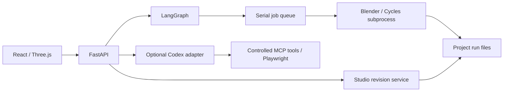

# 架構與開源抽離範圍

所有者：系統開發。正式入口是根 README，本目錄不保存案件資料。程式從既有本機工作台抽離；本 repo 為可獨立維護的快照，更新須明確合併，不會同步覆寫原工作台。

## 執行責任



LangGraph 保存確認與渲染續跑狀態，序列佇列執行重型工作。Agent 任務使用專用目錄與受控工具，幾何匯入、版本檢查和渲染由確定性程式處理。

本次已拆除舊 CAD 介面、API 與啟動依賴，新增獨立 CLI、案件初始化及可攜 Blender 路徑。前端不再依賴相鄰 plan_editor 套件，移除既有案件預設 ID。為保留 subprocess 與工作資料相容性，Python **內部模組仍稱 `interior`**，外部發行及 CLI 為 `roomweaver-studio`、`roomweaver`。請用獨立虛擬環境，勿和原工作台共裝。

## 資料權威

```text
workspace/
  projects/<id>/
    project.json, README.md
    sources/                       原始上傳副本
    workflows/interior-studio/      現行指標、不可變修訂、設計確認
    runs/interior-studio/<job>/     工作模型、圖片、試圖、結果、日誌
  artifacts/workbench/local/
    jobs.sqlite3                   應用佇列／事件／去重
    agent-checkpoints.sqlite3      LangGraph checkpointer
```

房間、物件、燈光及觀看點以案件修訂為準。保存帶 `base_revision`，過期修改回傳衝突；確認綁定版本，改動後要重新確認。Checkpoint 引用版本與工作 ID，大型檔案不放 DB。

提交使用 operation ID 去重；重啟核對已完成或中斷工作，不假設 checkpoint 等於副作用恰好執行一次。「要求停止」亦不等於當前渲染已立即終止。

## 備份與恢復

完整備份：等待工作停止、關閉服務，確認本 workspace 的 Blender 子程序不再寫入後，**整份複製 workspace 到另一位置**。保留案件、兩個 DB 及存在的 SQLite `-wal`／`-shm`，不能只備份其中一個 DB。

用相同程式版本及 `serve --workspace <還原路徑>` 啟動，先核對修訂與成果，勿立刻重新提交出圖。內建 `/api/studio/backup` 是狀態快照，不是大型案件檔案的完整備份。完整異機還原仍待正式驗收。

應用 migrations 與 LangGraph schema 分開管理；升級前保留完整副本，不在執行中搬 DB。備份保留週期目前自行管理，沒有自動七日輪替排程。

## 光影與品質

Three.js 材質檢視有展示光；光影預覽近似直接照明，不能取代 Cycles 間接光。出圖先查光源及鏡位，再試圖與影像檢查。自訂照明有有限輪次調整，Codex 判圖為明確選用。黑圖檢查僅避免明顯失敗，不是擬真驗收；幾何、UV／貼圖、尺度及人工構圖仍影響品質。

## 下一階段優化

| 優先序 | 建議 | 原因／完成方式 |
| --- | --- | --- |
| P1 | 材質編輯保留 PBR 通道，支援貼圖上的調色而非整體替換 | 現有基本色指派會取代物件材質與原貼圖；高品質範例首次應保留原材質 |
| P1 | 拆分 Studio.tsx 的資料 hooks、側欄與成果頁，增加瀏覽器回歸測試 | 保存／確認／切頁集中在大元件；拆分時維持 API 契約 |
| P1 | 固定 Codex 原生 binary 版本，加真實 App Server 相容驗證 | 本次沒有真實帳號測試；單元測試不能代替登入與模型驗證 |
| P1 | 版本化 scene schema 升級與跨機完整還原測試 | 證明舊資料可升級及成果可追溯 |
| P1 | 對大型、不可信 GLB 加入解析資源限制與 worker 隔離 | 大小與路徑檢查不等於解析器沙箱，公開部署前必做 |
| P2 | 延遲載入 Three.js／Agent 面板，拆分 bundle | 現在整包接近 1 MB，尚未做初次載入最佳化 |
| P2 | Linux 與不同 GPU 真實渲染矩陣 | 現階段僅 Windows 完整實測，不宣稱所有平台已支援 |
| P2 | 分離 worker 與 API 生命週期及可控並行 | 多使用者時再加入佇列服務、帳號、權限與 Postgres |

先保留 SQLite 與單一 adapter，不為未支援入口預建空框架。PNG 辨識、CAD／SKP 轉換、移動動畫及其他模型應各以真實輸入與驗收案例加入。
