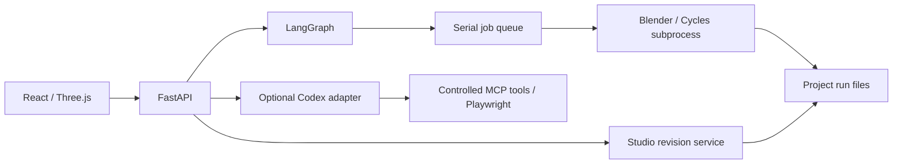

# 架構與開源抽離範圍

## 局部反饋執行邊界（2026-10-25）

`plan_semantics`工作種類沿用單一工作槽；`feedback_version=local-feedback-v1`在`run_semantics`入口直接分流至`semantic_feedback`，不進入YOLO、整屋JSON提案、來源全圖補漏或3D交接。M由後端強制分流，Q以明確ID與答覆修訂提交。草稿、物件圖層及用途表示共同綁定修正基底；沒有圖層不靜默切換資料集。

每筆補丁由宿主核對目標ID、原文新增授權、來源、類別、原始尺寸及實際差異；原生推導之後再次檢查範圍。必要裁切保存在工作結果的`feedback_clips`，重開時先套來源推導再套相同裁切。其他物件、未選Q及未完成物件問題保持；新增待辦不冒充問題已解決。衍生物件保留父ID，不能以拆分名義複製原件。任務結果保存一致性摘要，重新讀取與採用仍檢查逐項阻擋。

舊批次若只丟失了綜合物件圖層，可唯讀繼承同來源且幾何相容的凍結祖先；核對檔案雜湊及圖層一致性後明示`inherited_from`。沒有安全基底則保持待處理，不自動重畫或改寫案件歷史。

## Agent 工作列（2026-10-25）

所有者：共用 Studio 介面與 Agent 執行服務。右上角Agent入口整合「工作／設定」兩分頁，移除右下角浮動卡片及舊的設定覆蓋層。進行中／等待執行與已結束分開顯示；歷史每頁20筆，保留失敗、停止、中斷的狀態、原因、處理階段及批次範圍。

- `AgentHubProvider`在Studio根層保留模型偏好、登入檢查結果、能力測試與工作快照，跨首頁／專案頁維持同一份清單輪詢。`AgentWorklist`只呈現資料；慢速請求不重疊，分頁變更會中止過期讀取，失敗保留上次結果及其實際頁碼。
- 收合時僅保留上方入口與工作數量。寬度至少1200px時，`AgentHubFrame`以Grid預留360px側欄；較窄時暫時隱藏並inert主工作區，保留掛載與草稿，關閉時恢復捲動與焦點。側欄／兩個分頁保持掛載，各自捲動，不因開關重載場景。
- 專案側欄位於`EditorWorkspace`全螢幕容器內；專注模式入口移到既有畫面工具列。Esc在側欄內關閉並返回入口，窄版限制Tab焦點於面板。開啟狀態與分頁保存於`roomweaver.agent-panel.v1`；沿用`roomweaver.agent-model`，儲存不可用時仍可操作。新工作不改變開啟狀態。
- 設定沿用明確操作才執行的登入檢查、模型選擇及能力測試。材質候選在記憶體綁定原案件與來源修訂，只有原案件／同版本可採用；不因跨頁顯示而改寫案件。開啟面板本身不執行Agent、採用或能力測試。

- `GET /api/studio/agent/tasks?history_limit=20&history_offset=0` 只讀 `agent-tasks/<id>/task.json`，回傳 `active`、`history`、`history_total`、`unavailable`。摘要採欄位白名單，不回傳原始輸入、完整模型回覆或幾何候選，不啟動 Agent、續跑 workflow 或採用結果。前端每 2 秒讀取，10 秒逾時保留上次結果並說明讀取失敗。
- `agent_runtime/activity.py` 整理工作名稱、專案／平面 ID 及已選修改項或疑點範圍。新任務保存開始、階段、最近回報與結束時間，最多保存最近 20 次階段變更；模型事件只更新最近回報時間，不把輪詢當成 Agent 心跳。缺少時間的舊紀錄明示未記錄，未保存顯示摘要時可由同任務 input 唯讀整理。
- 摘要快取以工作檔的修改時間與大小失效，避免每次輪詢重新解析未變更的大型候選。快取可重建；原始 task/input/event 檔是執行紀錄，不可當作可丟棄暫存。單筆損壞不隱藏其餘工作，另回報不可讀取數量。
- 等待清單只包含已提交工作，不預建尚未發生的 Agent 步驟。M 批次仍是一個任務，範圍清單不代表各項已拆開排程；同平面互斥與 `Semaphore(1)` 維持。已完成指任務結束，不代表設計採用或驗收。
- 本列追蹤 `AgentTasks` 管理的判讀、Q/M 修正、配置、素材及能力測試。Blender 子程序內的照明／寫實精修等直接 Agent 呼叫仍隨原本出圖工作顯示，尚未合併為此列的獨立任務。建模、下載及渲染也沿用原工作頁進度。

實作入口：`agent_runtime/service.py`、`agent_runtime/activity.py`、`studio/api.py`及前端`AgentHub.tsx`、`agentHubContext.ts`、`agentHubState.ts`、`AgentWorklist.tsx`。合成回歸測試：`tests/test_agent_worklist.py`、`frontend/tests/agent-worklist.test.mjs`及`agent-hub-*.test.mjs`；不呼叫雲端模型。既有API、單一工作槽與渲染進度歸屬保持。

## 專案首頁與使用者資料夾（2026-10-20）

架構核對結果：`Store.project()` 是案件根目錄的集中入口；來源、平面修訂、場景修訂、素材包及出圖均相對該根目錄。工作佇列已把解析後的絕對 project root 寫入 subprocess 請求，Blender 引擎再驗證來源／輸出留在該根目錄。因此只需擴充登記與進度恢復，不必改寫渲染核心或搬移舊案。

- `ProjectHome.tsx` 是首頁，提供搜尋、排序、專案卡片與新建視窗；原 `StudioProject` 保留匯入、編輯及輸出 UI。進入專案後匯入 API 會攜帶 project_id，批次及新修訂歸在同一個專案，不增加另一張卡片。未指定 project_id 的舊收件 API 保留相容行為。
- workspace/projects 下的案件自動列入；外部資料夾以 `artifacts/workbench/local/project-library/registry.json` 登記 ID、絕對根路徑及顯示名稱。專案內的 project.json 不寫入機器路徑，來源與設定仍採相對路徑。目錄遺失或 ID 不符會明示不可讀取，不自動重建、改指或搬移。
- `directory_picker.py` 在獨立 GUI 子程序使用 Tk 的系統資料夾視窗，HTTP worker 不建立 Tk 物件。需要本機桌面及 Python Tcl/Tk；無桌面時明示不可用，不把瀏覽器上傳資料夾當成可寫入路徑。只有使用者選取後的短效 folder_token 能建立專案，前端不能提交任意根路徑。
- 選取與確認時均核對空白目錄；確認前不建立檔案。建立時只寫 project.json／README，按實際用途再建立 sources、workflows、runs 等目錄。改顯示名稱不重新命名資料夾；重送同一次確認不重複建立專案。
- `ProjectLibrary.resume()` 優先恢復尚未採用的新收件及其模型工作，再查已保存場景、同修訂出圖及綁定該修訂的頁面提示。新平面不會被舊場景搶先開啟；已完成未採用的工作走既有採用入口，不重新提交 Blender。
- 首頁只讀 workflow DB 與現有結果，不呼叫會推進圖狀態的 Coordinator.get。只有開啟專案後才接回原工作輪詢。卡片、排序與資料夾檢查不啟動 Agent、下載或出圖。
- `workflows/project-session/intake.json` 記錄目前匯入批次、來源、原場景版本與工作；採用時核對來源並記錄 adopted_job_id。`view.json` 只保存同一修訂可恢復的編輯分頁，過期提示忽略，不充當設計確認。
- 返回首頁與關閉頁面會檢查場景、平面及未送出的圖片補充草稿。可保存的草稿提供保存後返回；沒有獨立保存功能的圖片補充說明不會以保存名義啟動 Agent。背景工作不因返回首頁停止。

新增 API：GET/POST project-library、POST project-library/folders/pick、GET project-library/{id}/resume、PUT project-library/{id}/view（皆位於 /api/studio）。原案件、修訂、工作與成果 API 保持相容。

統一結構：project.json／README；sources/workbench 原始收件批次；sources/example 範例副本；workflows 設定與不可變修訂；runs/interior-studio 工作 BLEND／GLB、渲染與檢查。現有渲染仍在 runs 中提供下載，deliverables 只在明確整理正式交付時建立，不自動複製或搬移舊成果。

備份須同時保存使用者專案目錄與應用 workspace（兩個 DB、工作請求、Agent 歷史及 registry）。內建快照另保存 registry 證據副本與 project-session；恢復仍僅寫入當前已登記目錄，不信任備份中的任意目標路徑。資料夾搬移／重新定位、跨機開啟既有專案及背景工作跨機恢復尚未提供 UI。

## 檔案優先匯入（2026-10-20）

匯入頁沒有案件下拉選單。`ImportStart.tsx` 的三個主按鈕直接開啟各自的檔案選擇器；「開啟範例」使用 repo 內的 Project04 PNG／DXF／BLEND＋GLB，來源按鈕與範例按鈕互相獨立。

`studio/intake.py` 在指定專案內建立輸入批次（舊 API 未指定 project_id 時才建立獨立案件），再呼叫原有圖片收件、DXF 解析或 Studio 模型準備服務。圖片收件不啟動辨識；DXF 仍要確認平面後建模；3D 使用同一序列佇列、交接檢查及採用機制。GLB 範例先核對 manifest 雜湊並複製原生配對，不覆寫模板、不與上一次設計共用修訂。

- `GET /api/studio/intake`：讀取目前工作副本、未完成的 3D 匯入工作及三類範例可用狀態。無讀取副作用。
- `POST /api/studio/intake/upload?route=image|dxf|glb&operation_id=<32位hex>`：multipart 選檔，保留各格式大小與解析限制。
- `POST /api/studio/intake/examples`：`route`＋`operation_id`，從固定教學來源建立副本，不接受任意本機來源路徑。
- `artifacts/workbench/local/intake/current.json` 只保存工作副本與初始工作 ID；`operations/` 保存去重指紋及結果。設計權威仍是案件修訂。重送同一操作不重複建立案件；不同輸入使用相同 ID 會衝突；失敗／中斷不自動重跑。
- 可以用空 workspace 啟動。重新開啟由「繼續上次設計」恢復平面收件、未完成匯入工作或已保存場景。舊 CLI 登記的原生模型仍可從目前設計續開。
- 舊測試案件可以用 `project.json` 的 `studio_archived` 從登記清單移除；原目錄及直接 ID 查詢仍有效，避免破壞工作、來源與修訂引用。這不等於永久刪檔，也不套用到新的使用者匯入。

驗證涵蓋新 workspace 的六條 UI 入口、取消選檔、各自重開、兩次真實 Blender 準備、來源雜湊不變、去重及封存相容。圖片只驗證收件，不將其當成本輪 Agent 辨識通過。

## Generic intake and concept furniture（2026-10-12，本機）

- `GET/PUT image-plans/{id}/feedback` 保存不可變確認紀錄，綁定 `base_revision`／`base_feedback_id`。UI 輸入來源、原文、疑點範圍及數值確認，無案件腳本依賴。
- `refine` 傳入已保存的幾何、確認紀錄與既有證據背景。補丁按引用範圍驗證；已確認數值不可自行改寫，缺漏新增只能在明確回答的 missing 區域內，開口可依已引用宿主建立。最多兩次補丁回應，失敗不套用。`retry_of` 只允許明確重試同版失敗／停止任務；去重包含此識別碼。
- `image_review.question_notes` 依 Agent 像素框或來源元件產生問題標註；無位置則標示全圖且明說未知。問題 ID／數量與內容依每次輸入，配置提案以 `question_targets` 引用來源元件；無 Project03 特例。
- 修正另存 child intake；開啟前再次核對父修訂，保留高度、已確認尺度、尺寸約束、A→B 與歷次確認，不在讀取時修改原件。
- 家具區域採用分開 `hard_errors` 與待微調動線／操作區。放寬後者須明確 `accept_layout_limits`，以 `layout_adoption` 保存需求、覆蓋與未解事項，交接為 Scene `design_notes`；不改固定基線或允許推導地板冒充已確認。
- `GET/POST concept-furniture` 提供十類概念家具及標準幾何；無副作用。修訂 `concept_furniture` 保存類型、尺寸、穩定 ID 與由服務驗證的部件。Scene.objects/groups 必須完整包含原模型及新增部件，不接受任意網格或程式。
- `visualization/concept_geometry.py` 是共用目錄及部件權威。Three.js 依標準部件顯示，Blender 在工作副本建立相同尺寸部件，再套位移／軟刪除／子物件材質。復原可移除新增項，原始 GLB／BLEND 保持不變。

所有者：系統開發。正式入口是根 README，本目錄不保存案件資料。程式從既有本機工作台抽離；本 repo 為可獨立維護的快照，更新須明確合併，不會同步覆寫原工作台。

## 執行責任



LangGraph 保存確認與渲染續跑狀態，序列佇列執行重型工作。Agent 任務使用專用目錄與受控工具，幾何匯入、版本檢查和渲染由確定性程式處理。

本次已拆除舊 CAD 介面、API 與啟動依賴，新增獨立 CLI、案件初始化及可攜 Blender 路徑。前端不再依賴相鄰 plan_editor 套件，移除既有案件預設 ID。為保留 subprocess 與工作資料相容性，Python **內部模組仍稱 `interior`**，外部發行及 CLI 為 `roomweaver-studio`、`roomweaver`。請用獨立虛擬環境，勿和原工作台共裝。

## 資料權威

```text
workspace/
  projects/<id>/
    project.json, README.md
    sources/                       原始上傳副本
    workflows/interior-studio/      現行指標、不可變修訂、設計確認
    workflows/plan-import/          DXF 判讀、不可變平面修訂與現行指標
    runs/interior-studio/<job>/     工作模型、圖片、試圖、結果、日誌
  artifacts/workbench/local/
    jobs.sqlite3                   應用佇列／事件／去重
    agent-checkpoints.sqlite3      LangGraph checkpointer
```

房間、物件、燈光及觀看點以案件修訂為準。保存帶 `base_revision`，過期修改回傳衝突；確認綁定版本，改動後要重新確認。Checkpoint 引用版本與工作 ID，大型檔案不放 DB。

提交使用 operation ID 去重；重啟核對已完成或中斷工作，不假設 checkpoint 等於副作用恰好執行一次。「要求停止」亦不等於當前渲染已立即終止。

## DXF 匯入與共同交接

`studio/plan_import.py` 負責 ASCII DXF 解析、受支援幾何驗證、用途／尺度／高度設定與不可變平面修訂。`PlanImport.tsx` 提供匯入頁內的 SVG 平面核對；它不是現有 Three.js 俯視圖，也不執行 Agent。原件只寫入 `sources/workbench/`，案件決策不放在共用模組。

流程：上傳 → 保存／檢查 → 使用者確認該版本 → `studio.prepare`。固定操作鍵綁定平面 ID＋修訂，既有序列工作佇列執行 `visualization/plan_blender.py`。它建立牆、地板、門窗洞與家具占位，保留來源元件 ID，再接既有 `studio_blender.py`，產生同版 BLEND／GLB／model.json。沒有新的第二套重型佇列。

共同交接會檢查非空／唯一物件 ID、GLB 到原生物件的對應、世界座標包圍盒（公尺，Y-up／Z-up 轉換；容許 2 cm 或軸向範圍 2%）、模型雜湊與外部貼圖引用；`handoff.json` 保存證據。這不是逐頂點等價證明。原生獨有物件會列出，可編輯狀態與照明／渲染就緒分開。採用工作前重新檢查檔案，避免把被改動的完成結果掛入修訂。

API：`POST /api/studio/projects/{id}/plans/upload`（multipart）；`GET .../plans/current`；`PUT .../plans/{plan_id}`（base_revision＋settings）；`POST .../plans/{plan_id}/build`（plan_revision＋目前 Studio base_revision）。保存與建立皆拒絕過期版本，原件 SHA 改變即拒絕重播。平面確認是本地保存狀態；採用模型後接原有 LangGraph 設計／渲染流程。

此功能獨立實作於本 repo，不依賴母工作區案件、Skill runtime 或完整舊四階段交付。既有 `concept-2` 呈現核心並未全部移入；精細家具可透過下方 BlenderKit 配對替換。DWG 已有原生讀取／ODA adapter；SKP 的免費本機 OpenSKP adapter 見 [SKP 匯入](SKETCHUP_IMPORT.md)。

## 備份與恢復

完整備份：等待工作停止、關閉服務，確認本 workspace 的 Blender 子程序不再寫入後，**整份複製 workspace 到另一位置**。保留案件、兩個 DB 及存在的 SQLite `-wal`／`-shm`，不能只備份其中一個 DB。

用相同程式版本及 `serve --workspace <還原路徑>` 啟動，先核對修訂與成果，勿立刻重新提交出圖。內建 `/api/studio/backup` 是狀態快照，不是大型案件檔案的完整備份。完整異機還原仍待正式驗收。

狀態快照 format 2 同時包含 `interior-studio` 與 `plan-import` 設定；還原器亦接受舊 format 1。平面修訂與指標會一起恢復，保留還原前快照，不會因還原而提交建模。原始 DXF、GLB、BLEND 仍需隨整份 workspace 備份。

應用 migrations 與 LangGraph schema 分開管理；升級前保留完整副本，不在執行中搬 DB。備份保留週期目前自行管理，沒有自動七日輪替排程。

## 光影與品質

Three.js 材質檢視有展示光；光影預覽近似直接照明，不能取代 Cycles 間接光。出圖先查光源及鏡位，再試圖與影像檢查。自訂照明有有限輪次調整，Codex 判圖為明確選用。黑圖檢查僅避免明顯失敗，不是擬真驗收；幾何、UV／貼圖、尺度及人工構圖仍影響品質。

## 下一階段優化

| 優先序 | 建議 | 原因／完成方式 |
| --- | --- | --- |
| P1 | 材質編輯保留 PBR 通道，支援貼圖上的調色而非整體替換 | 現有基本色指派會取代物件材質與原貼圖；高品質範例首次應保留原材質 |
| P1 | 拆分 Studio.tsx 的資料 hooks、側欄與成果頁，增加瀏覽器回歸測試 | 保存／確認／切頁集中在大元件；拆分時維持 API 契約 |
| P1 | 固定 Codex 原生 binary 版本，加真實 App Server 相容驗證 | 本次沒有真實帳號測試；單元測試不能代替登入與模型驗證 |
| P1 | 版本化 scene schema 升級與跨機完整還原測試 | 證明舊資料可升級及成果可追溯 |
| P1 | 對大型、不可信 GLB 加入解析資源限制與 worker 隔離 | 大小與路徑檢查不等於解析器沙箱，公開部署前必做 |
| P2 | 延遲載入 Three.js／Agent 面板，拆分 bundle | 現在整包接近 1 MB，尚未做初次載入最佳化 |
| P2 | Linux 與不同 GPU 真實渲染矩陣 | 現階段僅 Windows 完整實測，不宣稱所有平台已支援 |
| P2 | 分離 worker 與 API 生命週期及可控並行 | 多使用者時再加入佇列服務、帳號、權限與 Postgres |

先保留 SQLite，不為未支援入口預建空框架。SKP 轉換已加入背景 prepare 工作；更廣 CAD 支援、移動動畫及其他模型仍應各以真實輸入與驗收案例加入。


## 圖片入口（2026-10-11）

`studio/image_plan.py` 管理圖片收件、可追溯正規化、辨識契約與候選採入。`AgentTasks.plan_image` 透過既有 Codex App Server localImage 執行限定任務，不建立第二套 Agent 迴圈；JSON 嚴格驗證、最多 150 個元件、有限座標、唯一 ID 及已存在宿主。回應保留 model/version/thread/turn 與原始文字。模型不能提交 Blender 工作。

明確分開 upload、recognize、draft、save、build。上傳沒有模型副作用；同一收件識別碼的辨識與候選採入皆去重。狀態保存於 `plan-import/<id>/image.json`，終態回應複本在 `recognition-result.json`，原始 Agent 任務在本機 state。重啟後未完成任務顯示 interrupted，不自動重送。照片及模型回應是資料，不可指定檔案路徑或執行程式。

圖片候選座標採正規化圖片左上為原點的像素座標。保存的 calibration 明確記錄兩點、實際公尺與確認狀態；建模轉成公尺 Y-up，再沿既有共用入口轉換為 Blender 座標。assignment.points 是人工更正，settings.additions 是人工新增幾何，原始 parsed.features 永遠保留。reviewed 引用不可變疑點 ID。build 必須帶精確 plan_revision、場景 base_revision 及 confirmed=true，並重跑比例尺、疑點、來源雜湊及幾何檢查。

新 API：`/projects/{id}/image-plans/upload|current`，`/image-plans/{image_id}` 與其 `/image`、`/recognize`、`/draft`。確認、保存、建模重用 `/plans`。React 的 `ImageImport` 負責圖片與任務，`PlanImport` 共用確認介面，`Studio` 只負責入口與建模後接回編輯。

先以 JSON 轉錄和人工校正完成概念路徑；精準尺寸約束求解、影像透視校正、複雜曲牆、向量 DXF 匯出與 Agent 多輪修圖仍未實作。

## Image recognition review v2

`studio/image_review.py` owns overlapping crops, review prompts, dimensional residuals and bounded host projection. `agent_runtime/service.py` performs two explicit visual calls within one durable task: inventory -> crop review -> deterministic audit. Each pass records raw response/model/thread/turn; crops carry full-image boxes and actual resize dimensions. Invalid second-pass output fails the task, rather than silently using an unreviewed first pass. Stop is checked between calls.

`Recognition` adds optional `dimensions` (raw text, metres, pixel endpoints, endpoint evidence, confidence) and `review` (localized actionable issues). Old responses remain readable. The task—not a model-provided boolean—records whether review completed. New drafts keep `parsed.recognition_audit`, dimensions and informational notes; immutable old revisions are untouched. Source/candidate coordinates and auto-corrected plan are independently traceable through pass records and correction before/after values. Only a high-confidence dimension with two distinct endpoints may supply a scale suggestion; no dimensional constraint solver is claimed.

Human gates remain: scale, actual unresolved review items, valid geometry and final build confirmation. The common Blender queue, source hash checks, optimistic revisions and deduplication are unchanged. Agent schema success is not design acceptance. Client-specific measurements and reference CAD stay in ignored local validation artifacts, never runtime prompts or public fixtures.


## Image evidence refinement v3

`studio/image_evidence.py` reconciles an explicitly scoped evidence packet with a saved image draft. POST `/api/studio/projects/{project}/image-plans/{image}/refine` accepts `base_revision`, `model`, `evidence`. Each evidence record has `id`, `source`, `text`, optional `source_sha256`, `question_ids`, `resolves`, and `dimensions` (`dimension_id`, accepted `text`, `metres`, optional pixel `text_box`). The caller is responsible for linking actual same-case confirmations and selecting the current authoritative revision; the service does not search the filesystem, authenticate a quoted statement, or independently verify a supplied source digest. Original image hashes and saved draft revision are verified by the service.

The structured packet distinguishes an accepted measurement from permission to close an entire issue. Partial evidence cannot close a question. Model edits require valid citations and must lie within cited question/measurement scope; new apertures require an in-scope host. Features cannot be deleted by this patch. Conflicting accepted values, duplicate IDs, incomplete resolutions and invalid geometry are rejected. Source text is untrusted input, never a command.

`AgentTasks.plan_refine` performs at most two calls: optional independent numeric crop reading, then image/evidence reconciliation. Numeric reading receives no accepted values or prior OCR, only enlarged original pixels at 0/90/270 degrees and image-coordinate metadata. Accepted bound values are applied deterministically after model patches, retaining original OCR in `raw_text` and references in `source_refs`. Pixel endpoints remain separate. The task records both model responses and all source bindings; no second autonomous Agent loop or blind retry is introduced.

The operation forks a new intake from the saved plan, including manual additions, offsets and same-role heights. Original images/revisions remain immutable. Identical requests deduplicate within the source intake; stale revisions are rejected. New draft creation is separately gated on task success, retains human scale/build gates, and never queues Blender. Source image and normalized-image digests are rechecked before adoption. Stop between calls prevents the next call; failures/interruption require explicit new work. As elsewhere, UI review does not constitute design acceptance.

`EvidenceReview.tsx` presents resolved answers and traceable sources. `PlanImport` displays original OCR alongside confirmed values. The evidence submission endpoint is currently a maintainer integration, not an end-user document importer. Case-specific records and live responses remain in ignored runtime/artifacts locations. Generic regression tests use synthetic drawings and values.


## Rectilinear reconstruction and source annotations v4

Source transcription and reconstructed geometry are now explicit layers. `parsed.features` remains the source pixel record; `settings.assignments[].points` holds edited/reconstructed coordinates. `plan_rectify.py` unions shared vertices and axis equalities for near-horizontal/vertical wall/floor edges; diagonal triangulation edges are retained. Walls beyond the direction classification threshold are rejected. Apertures retain their parametric position along a unique original host segment. This does not infer new room boundaries, join nearby but disconnected nodes, or resolve CAD topology globally.

POST `/api/studio/projects/{project}/plans/{plan}/rectify` requires `base_revision` and `orthogonal_confirmed: true`, plus optional `bindings`. A binding is `{dimension_id,start:{feature_id,vertex},end:{feature_id,vertex},axis:"x"|"y"}`. It must reference an accepted dimension whose value/source can be matched to the same draft's evidence records. Axis-group constraints are solved exactly through relative offsets; free translation alone is chosen using original positions. Inconsistent length cycles reject the whole operation. Source/unknown measurements are not averaged. The full plan geometry check rejects new errors before saving an immutable revision; scale and review gates remain. Subsequent edits/builds recheck the adopted orthogonality and bound lengths.

`settings.reconstruction` records parent revision, count of changed objects, explicit bindings and limits. A zero-binding result is angle cleanup, not a completed measurement reconstruction. Pixel source bounds still constrain this initial implementation; layouts needing a larger working canvas must be handled explicitly. Ordinary PNG inference only records pixels; the prompt explains that subsequent measured reconstruction takes precedence over hand-drawn slopes. This is not a general free-angle constraint solver or finished-face offset modeller.

`settings.question_notes` stores per-question `title`, `known`, `ask`, source-pixel `regions[{label,box}]` and an `answer`. IDs must belong to the same parsed question set; boxes must fit the original image. These are revisioned UI annotations, not dimension endpoints. `QuestionReview.tsx` renders the unmodified image with SVG overlays and optional display rotation; user answers remain separate from acceptance checkboxes. A maintainer currently supplies the region mapping. `canvasWheel.mjs` installs non-passive listeners only on both interactive SVG canvases, with cleanup on unmount; it cancels page scrolling while zooming.


### Bound dimensions and source marks (local development)

`PlanSettings.source_marks` stores immutable-image pixel endpoints, a description and optional question ID. Display rotation is invertible and does not modify the source coordinates. Marks never become measurements or approvals automatically. Bounds, duplicate IDs and question ownership are validated. `dimension_cautions` stores sourced historical conditions, separately from current measured residuals.

`DimensionBinding.mode` defaults to `vertices`; `opening_width` requires vertices 0/1 of one explicitly hosted door/window. The solver checks confirmed source values, keeps the host, preserves exact width and minimally translates its centre within an existing straight host run. It rejects oversized/conflicting constraints without averaging. Contiguous collinear host segments are validated as one run; corner bends are not merged. Incomplete unbound additions remain unchanged and continue to block building. Existing user confirmations are invalidated only for questions referencing actually changed features.

`check.dimension_report` recomputes applied/pending/conflict status from saved geometry and authoritative dimension values. Unsaved UI changes show stale-result notices. Revisions, original transcription and source bytes are retained. No cloud Agent call is needed for constraint application or annotation saving.


## Optional AI spatial layout

`studio/layout_design.py` adapts requirement coverage, immutable fixed-site boundaries, furniture footprints, operation areas and route-width checks from the original layout workflow. It imports no private project or original platform module. Shapely 2.1.2 performs deterministic planar checks; Codex proposes semantics and repairs at most twice. This is a bounded task in the existing Agent runtime, not an additional autonomous Agent loop.

Plan confirmation owns this optional stage for both image and DXF inputs. The immutable source revision and hash are bound to each request. Coordinates sent to the Agent are normalized metre XY; adoption maps them back to DXF units or image pixels (including Y inversion and source origin). Existing furniture can only move/rotate if explicitly authorized. Walls, apertures, floors, source recognition and confirmed dimensions are retained. A final plan check must pass before saving the adoption revision.

API under `/api/studio/projects/{project}/plans/{plan}/layout`: POST starts with base_revision/model/operation_id/brief/requirements/movable_ids/passage_width; GET current and GET {id} recover saved candidates; POST {id}/stop requests cancellation; POST {id}/adopt requires matching revision and accept_assumptions=true. Same operation ID with changed content is rejected. Replayed adoption returns the same revision; later edits block stale adoption. Agent completion and geometric acceptance are separate states. Interrupted tasks do not restart automatically.

Case data: `workflows/plan-import/{plan}/layout-design/` owns request snapshots, candidate/result, check report and adoption record. `current.json` is an index; immutable plan revisions remain authoritative. Agent event traces retain the existing local state location. No new database is introduced. New `design_asset` on furniture assignments selects deterministic Blender geometry with stable assembly/child IDs; the common handoff checks GLB/native object and spatial agreement.

Limitations: floor semantics and scale must already be confirmed; no arbitrary GLB-to-floorplan conversion. Door swing sweeps, utility access and product-specific operation clearances are not fully represented. Route checks test supplied corridors, not proof of a globally optimal or universally connected circulation network. Accepting a candidate is concept-design approval only. Rebuilding from the plan creates a new model baseline; downstream scene edits are not automatically rebased.

### Existing requirement context and staged intake

GET/PUT `layout/brief` reads or creates an immutable requirement packet bound to `base_revision`: `brief`, `requirements`, curated `context`, and source labels/references/SHA-256. PUT is a maintainer integration, not an arbitrary filesystem reader. It never changes the plan. Packets live in `layout-design/briefs`, indexed by `brief-current.json`; POST layout optionally references `brief_id` and rejects stale context. Saved question answers are included in every image-plan site packet, independently of a supplied brief. Context remains evidence, not instructions to bypass protection. Private case packets stay outside the public repository.

The three intake panels remain mounted while hidden, preserving edits and canvas handlers. Confirmed sections use collapsible panels. `layoutReadiness.mjs` exposes actionable prerequisites instead of a silent disabled button; building consent is deliberately not an Agent prerequisite. Collision feedback includes actual world-space overlap bounds; narrow existing doors and disconnected floor polygons are reported separately without silently patching the source. A successful Agent task means a structured proposal was produced, not that the geometry or design passed.

An invalid final repair does not erase earlier structured candidates. `recover_layout_pass` revalidates prior proposals against the original request's site, retaining the latest valid structure with a recovery notice. Existing failed tasks can expose this as a read-only preview from their saved passes; the failed task status and original files are not rewritten, and adoption remains prohibited. This is not a fallback to a different model or a relaxation of geometric checks.

Layout POST optionally accepts `parent_id` to resume a candidate with retained object IDs, assets, physical dimensions, requirement links and route names. The same preservation rules apply to each model response and recovered pass. `POST {id}/revise` accepts a structured candidate, `base_revision`, operation ID, rationale and hashed source references; it creates an immutable `reviewed_revision` with task status `preview`. It neither starts a model nor adopts geometry; requests are deduplicated and adoption remains blocked. References are provenance metadata, never filesystem-read instructions. Route reports distinguish moved furniture, fixed equipment, walls and missing floor coverage. `UseZone.kind=seated` requires an adjacent facing chair, a desk/table, full chair coverage and a separate chair clearance zone. Only that chair is exempted inside its seated area; circulation still treats it as an obstacle.


### Layout source questions and preview inference

Reviewed revisions accept `source_questions` with image-pixel regions. GET/PUT `layout/{id}/answers` stores immutable answer snapshots with `base_revision`, `base_answer_id`, answers keyed by question ID and A→B `source_marks`. Unknown IDs, out-of-image/nonfinite or coincident endpoints, stale source revisions and concurrent answer writes are rejected. Saving never changes geometry, review acceptance or task status. Parent-based Agent tasks receive saved question evidence; answer content remains source material, not an instruction to bypass validation. The UI retains a local draft per run/revision and requires explicit save into the case.

`floor_gap_tolerance` (0–0.25m) and `excluded_floor_ids` are preview-only review inputs: short traced gaps may be joined without removing existing wall obstacles. Polygons retain interior holes, furniture and use zones must still fit the original floor, and route reports flag `inferred_floor`. Inferred routes cannot produce a ready report; adoption also rejects inferred sites. A morphological connection is not surveyed geometry or permission to change confirmed dimensions. Cyan overlays expose this uncertainty instead of reporting a successful design.


### BlenderKit assembly matching and replacement

`studio/staging.py` proposes revision-bound decor and lighting placements from actual GLB/concept bounds. It adds no second Agent loop or rendering queue: applying a proposal saves an immutable scene, then starts the existing `AssetBatch` for its selected additions only. Stable support/type IDs prevent duplicate additions; failed rows can be retried through the UI. Layout is deterministic, catalog search/ranking uses Codex, downloads and model fit remain application-validated. Ceiling fixtures have separate bound lights and a top-mounted fitting rule. Existing furniture height safeguards are not relaxed for decorative objects. No automatic storage cleanup is performed.

`StagingPanel` and `AssetBatch` share `syncAssetBatch`: the final scene must finish loading before publishing a terminal batch status, because that status tears down polling. Concurrent unsaved edits cannot be overwritten by a late response. Synthetic fixtures in `tests/fixtures/staging/` exercise placement without any Project03 IDs or coordinates.

See [BLENDERKIT.md](BLENDERKIT.md) for the UI and endpoint contracts. Catalog requests use a fixed official host allowlist and bounded responses. Codex generates search words and ranks verified IDs; model output never supplies download URLs or executable code. Free candidates sort before paid backups, and paid downloads require explicit selection and existing user entitlement. Credentials stay in the backend environment.

Replacement is a revision-bound `studio.replace` queue job. Blender works on a new snapshot, retains unrelated native object identities and revision edits, regenerates GLB and checks its spatial/native mapping before adoption. Assembly identity and bound lights remain stable; selected material slots detach shared mesh data. Source links persist on the assembly or material assignment. Sources and provenance remain available; superseded replacement binaries are reclaimed after explicit whole-batch review as described below. Stale completion never overwrites current edits. Native lighting proposals may follow a validated replacement ancestry.


### 批次配對、旋轉與素材保留策略（本機）

`asset_batch.py` 保存可檢視的目標快照，使用同一 Agent 執行器依序配對，單件結果仍由 `asset_matching.py` 驗證及採用。沒有新增另一個自主 Agent 迴圈；圖片是使用者明確選用的風格參考。配對結果允許沿同一模型 lineage 使用，但目標內容必須一致，或目前採用來源可證明是同一份候選清單的替換。

ObjectGroup 新增可選 `rotation`（水平角度）與 `rotation_pivot`（Blender XYZ 公尺），舊場景按 0 處理。Three.js 與 Blender 皆套用 `Translate(delta+pivot) × RotateZ(angle) × Translate(-pivot)`；綁定光源同樣變換。

素材保留策略改為保留現用模型及來源紀錄。`asset_storage.py` 在全體確認後清理已採用 replacement 的祖先大檔、現用下載暫存及本批次未採用工作；保留原始匯入、其他獨立未採用結果、照明依賴及圖片。先寫退休標記再刪除檔案，修訂保存與工作提交拒絕已退休模型。工作執行中暫緩；不保證歷次替換均能離線還原，備份／恢復也不能讓已清理模型重生。


### 自動第一版與最終確認

`asset_automation.AutoPlacement` 在 Agent 搜尋結束後，將每個目標的免費候選依序交給既有 Blender 工作佇列。狀態、嘗試過的候選、工作 ID 及當前修訂存於案件 batch 的 `placement.json`；不建立第二個渲染佇列。固定操作 ID 去重，恢復時核對既有工作與實際採用場景；其他編輯造成版本變動則暫停。每一個目標都保留結果，不用 parent Agent 的 passed 代表整屋替換成功。

新增 batch `/stop`、`/resume`、`/confirm`。只有綁定現行修訂的全體確認可啟動清理；未替換項目須明確保留原件。新語義取代先前「每次 adopt 自動清理」。原始匯入、現用模型、照明來源及非本批次未採用工作受保護；備選中繼資料不刪除。

### Manual area additions and direct catalog links

`placementArea.ts` normalizes 2D drag direction into Blender XY metres; visible surface raycasts provide an editable bottom height. `AddFurniture` creates the existing concept geometry; `SpaceEditor` saves it as an immutable revision before requesting matching. Group `editor_kind`, `design_prompt`, and `model_url` are optional backward-compatible fields preserved through replacement. Classification is explicit for new items, with concept/name fallback for older imports.

`POST .../asset-links` accepts a revision-bound assembly and an official BlenderKit asset UUID URL. It reads bounded catalog metadata and creates the same persisted candidate contract used by Agent matching, with source `link`. Operation IDs prevent duplicate metadata creation, revision checks reject stale targets, and the existing replacement service rechecks authorization, price, license, geometry and provenance. Search failures leave the saved placeholder available for retry. No arbitrary URL downloader or second adoption path is introduced.


### DWG → DXF → 平面確認（2026-10-20）

`studio/dwg_conversion.py` 使用獨立的本機 ODA 子程序，固定參數、隔離單檔輸入目錄、120 秒上限、停用 audit 與遞迴。以選定專案的 `sources/workbench` 保存 DWG 原件，衍生檔與轉換 manifest 放 `runs/plan-conversion`。`PlanIntake.create` 共用兩個上傳入口的轉檔與 parser，不另建工作流或自動略過確認；packet.source 保留 DXF、original 與 conversion 關聯及雜湊。建模前再次核對 DWG／DXF，保留既有修訂／工作去重。

長時間轉檔不持有全域 Store lock；IntakeSessions 自己序列化匯入操作識別碼。只有通過解析並產生完整設定後才更新平面 current 指標；操作失敗保留原件／日誌與舊指標。環境變數或 workspace runtime 管理執行檔位置，案件僅記工具名稱／二進位雜湊及格式參數。來源、runs 與流程修訂須一起備份；現有 DB 快照不包含大型案件檔案。


### 共用 CAD 自動整理與確認

`cad_preparation.py` 將曲線離散、填色邊界／孔洞、受控 Z 投影、DIMENSION 端點／覆寫值與候選地板整合為 parsed.cad_preparation。來源 DXF／DWG 不變；新匯入自動執行，舊封包透過 revision-bound `/plans/{id}/prepare` 產生新修訂。UI 只在明確開啟未整理的 CAD 平面時升級，GET／首頁列表不改寫資料。沿用可對應的人工物件設定；僅仍等於舊版自動預設的細節分類可更新，已修改高度、名稱與頂點等設定保留。

地板從房間標籤、封閉線網、具來源的填色或尺寸端點／四側線圖支持取得，保留孔洞與不連通區；受約束三角化後合併凸片，核對總面積，微小數值碎片容差合計限 1e-6 m²。不使用凸包／bounding box 自動填屋。高程投影只允許單一主要平面的證據門檻；原始 Z 範圍保留在 action ledger，非建模高度。

cad_unit_confirmed／cad_unit_evidence 與 reviewed 保存單位及推定範圍答覆；後續一般保存拒絕更改已確認單位。尺寸覆寫與端點不一致會列為疑點而不改動端點；重新整理後重設改變的 CAD 疑點答覆，避免舊確認套到新範圍。來源／舊修訂保留，沒有自動建模或採用。


## 圖面語意交接

`studio/plan_semantics.py`：來源圖像／文字／幾何／尺寸的受限 Agent 判讀、來源與幾何檢查、有限複核、預覽及不可變採用；`intake_contract.py`：UI 建模交接與家具存在性分支。`PlanSemantics.tsx` 於 01 顯示判讀與疑點，`PlanImport.tsx` 核對並保存。CAD 自動整理不等於語意理解。詳見 [交接標準](INTAKE_STANDARD.md)。


語意複核補強：`semantic_evidence.py` 負責來源外框證據、缺引用補足、房間入口拓撲、Q 定位與衍生 SVG。`SemanticSourceReview.tsx` 及 `semanticSource.mjs` 使用同一來源取景記錄，呈現原圖／候選地板／疑點；答覆使用平面修訂及答覆修訂雙重檢查，保留同案歷史。這些能力共用 PNG／CAD 輸入，不綁案例座標。
