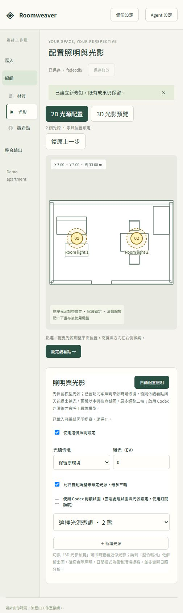

# 獨立版驗證紀錄

日期：2026-10-10。範圍：Roomweaver Studio 本機首次抽離版本。環境：Windows、Python 3.11.9、Node.js 24.19.0、Blender 4.5.14 LTS。

| 驗證 | 結果 |
| --- | --- |
| 新建 Python venv、安裝基本／dev 套件 | 通過 |
| npm ci、TypeScript 檢查、Vite build | 通過；bundle 大小警告仍存在 |
| Python 單元／契約測試 | 37 通過，含範例原件保全、雜湊及路徑拒絕 |
| 前端測試 | 29 通過，含平面材質還原及匯入日光隔離 |
| Blender 整合套件 | 10 通過，另有 2 個 subtests 通過 |
| 真實 API smoke | 匯入 GLB → 保存 → 確認 → 渲染 → 完成；2 張全景、2 張效果圖，尺寸與品質檢查通過 |
| 瀏覽器操作 | 新 DEMO 空白匯入 → 編輯；椅子分為兩組、各 6 子物件；照明提案找到 2 燈、保存成功，Codex 判讀關閉 |
| Wheel 建置與安裝 | 另一個全新 venv 安裝 wheel，包含 UI、Blender 腳本與授權；未安裝 Agent extras 仍能提供頁面及案件 API |
| 依賴一致性 | pip check 通過 |
| 發布檔案檢查 | Git 清單未含 runtime、原案件、已知私人路徑或典型憑證字串；並非完整安全稽核 |

合成模型出圖見 [效果圖](../examples/demo-apartment/render-preview.png)。人工目視確認該圖有照明與家具，並未把簡單幾何評為照片級成果。

本機詳細證據位於被 Git 排除的 `artifacts/`，包括 smoke 報告、Blender 工作結果、wheel 安裝與檢查紀錄。可依根 README 的命令重新生成；這些私人機器日誌不隨公開 repo 發送。

未驗證：獨立版真實 Codex 訂閱／雲端模型與 browser Agent、4096×2048 正式品質、異機完整資料恢復、Linux／macOS 全流程、大型外部模型。GitHub Actions 的首次遠端結果以 repository Actions 頁為準。API smoke 與瀏覽器操作為分開的驗證，並非全套 UI 自動化測試。

## 日光公寓增補

2026-10-10：9 項免費 CC0 BlenderKit 資產（4 家具、4 材質、1 HDRI），來源與 SHA-256 在範例 assets/manifest.json。GLB 含 26 張嵌入圖片、228 個網格。原生場景生成兩張 1440×1080、96 samples Cycles 圖，人工目視修正牆面及布料比例。

原生配對另經完整應用 smoke：匯入 → 修訂 → 確認 → 2 張全景＋2 張效果圖成功，未呼叫雲端模型；詳細證據保留在本機 artifacts/daylight-smoke-v1。GLB 單檔另含點錐光近似，不宣稱保有 HDRI world。

## 編輯平面泛白修正

日光公寓的 GLB 日光強度約 1229，原先與編輯補光疊加造成泛白。2D 改用不受光照及曝光影響的基本色／貼圖；一般 3D 編輯隔離匯入燈光，光影頁繼續使用採用設定建立預覽。原件、案件修訂與 Cycles 渲染未更動。

29 項前端測試及正式建置通過。以既有日光公寓 smoke 工作區實際開啟瀏覽器，核對平面辨識開／關、床的選取框、單物件展示及返回 2D，無頁面執行錯誤；截圖保留在本機 artifacts/plan-*.png。本輪沒有重新渲染。
