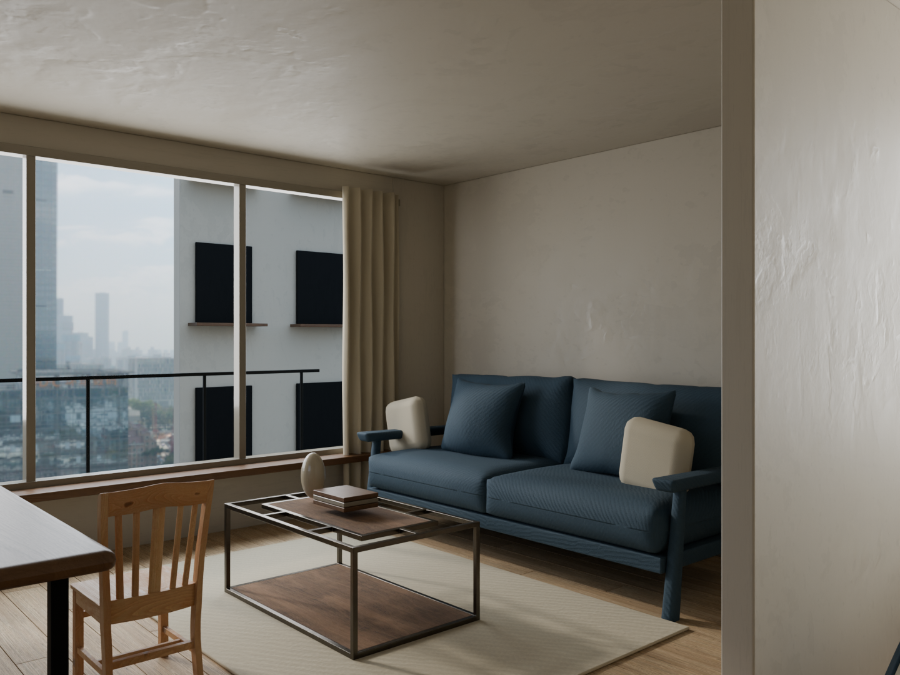
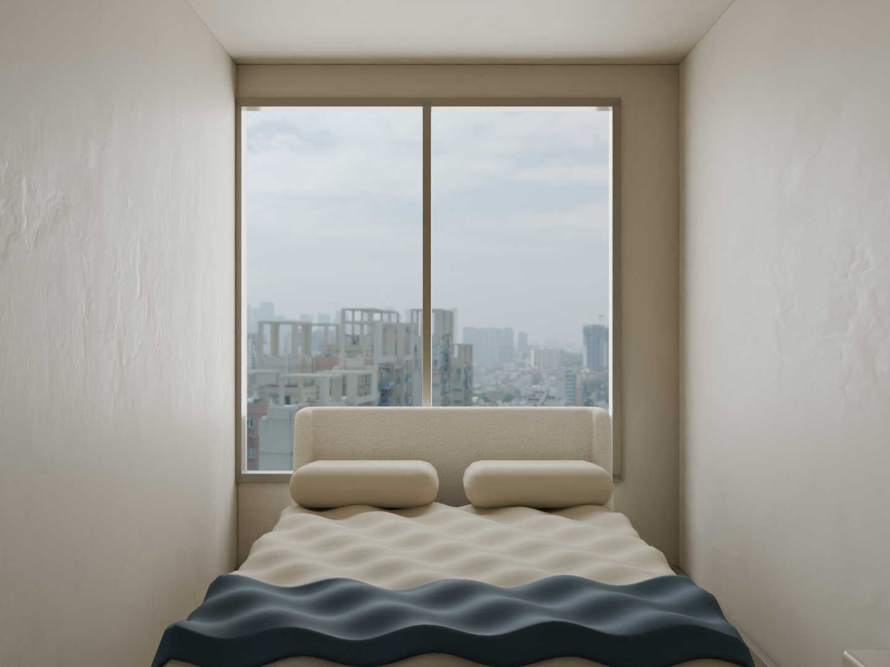

# Daylight apartment — 日光公寓

這是公開教學用虛構公寓，沒有客戶平面圖或私人素材。目的為展示比最小 smoke fixture 更完整的日光、材質、家具與攝影配置。




## 使用完整光影範例（建議）

GLB 無法保存 Blender 的 HDRI world 與原生面光源。因此同時提供幾何對應的 **`.blend`＋`.glb`**，前者渲染、後者編輯預覽；不能把兩者差異藏在宣傳圖裡。

依根 README 安裝、設定 `INTERIOR_BLENDER` 後，在 repo 根目錄執行：

```powershell
.\.venv\Scripts\roomweaver.exe example --workspace workspace
.\.venv\Scripts\roomweaver.exe serve --workspace workspace
```

1. 匯入頁的案件選 **Daylight apartment · DAYLIGHT**。
2. 點 **「使用案件現行模型」**，等待工作副本建立。
3. 首次保留原材質與照明；本版基本色指派會替換該物件原貼圖，若要重現範例請先只檢視。若需調光，在光影頁「自動配置照明」取得現有光源，再保存。不要啟用 Codex，除非已完成自己的帳號測試。
4. 觀看點已有 Living、Bedroom 及各一個方向，可用 3D 預覽核對再調整。
5. 「確認編輯，前往整合輸出」→ 先低解析出圖 → 人工檢視 → 選正式尺寸再提交。

此命令核對 SHA-256、複製原件及登記來源，不直接出圖或替使用者確認。重複 ID 會拒絕覆蓋；另一份可用 `--id DAYLIGHT_2`。匯入後的案件資料在 workspace，可繼續用自己的模型建立其他案件。

只想測試一般上傳，可直接匯入 [daylight-apartment.glb](daylight-apartment.glb)。它含貼圖、幾何與窗外近似點錐光源，但 **不含 HDRI world**，光照與原生配對不同。要重現上圖請使用配對模式。窗玻璃刻意不加入可攜版，避免不同渲染器的透射陰影不一致。

## 本範例如何改善品質

| 項目 | 設定 |
| --- | --- |
| 光影 | 窗外日光＋兩處窗洞天空面光，沒有每間房間平均補亮；保留家具底部與牆角陰影 |
| 窗外 | BlenderKit CC0 城市 HDRI，以及原創陽台欄杆與鄰棟幾何；**示意環境，非實際基地照片** |
| 配色 | 暖灰白牆、淡橡木地板、米灰櫃面、藍灰布沙發、少量深灰金屬 |
| 材質 | BlenderKit 木紋、布料、灰泥掃描貼圖；調整色彩、UV 尺度與正常方向；地板及家具使用不同木紋 |
| 細節 | 免費 CC0 沙發、茶几、椅子、床；另建窗框、窗簾褶皺、櫃門接縫、枕頭及書本 |
| 攝影 | 32 mm、水平視軸、AgX；提供 1440×1080、96 samples、去噪的原生範例圖 |

這是單層床公寓，沒有聲稱包含上下舖。布料和牆面以實際尺度的細微紋理為主，金屬／陶瓷透過不同粗糙度、金屬度與塗層表現；並非每個子材質都有完整四張 PBR 貼圖。原始家具已有的貼圖保留，部分純色細節使用簡單 shader。物件及材質仍需人工檢查，不能把採用資產當成品質自動保證。

## 檔案、來源與重建

- `assets/manifest.json`：逐項作者、免費狀態、CC0 授權、網址、版本及 SHA-256。
- `assets/*.blend`／`city-sky.exr`：已取得可重分發的原件，可離線重建。不包含 Royalty Free 素材。
- `build_example.py`：場景生成、原件檢查、貼圖調整、GLB 與 native 配對及真實渲染。
- `manifest.json`：輸出雜湊及建議觀看點。
- `layout.png`：同模型上視圖，僅供理解布局，不是自動建模的輸入。

在 repo 根目錄重建（會更新本範例的生成檔，先保存自己的變更）：

```powershell
& $env:INTERIOR_BLENDER --background --disable-autoexec --python-exit-code 1 --python examples/daylight-apartment/build_example.py
```

重建只使用這個目錄，不依賴原工作平台或使用者帳號。可另執行完整應用管線測試：

```powershell
.\.venv\Scripts\python.exe tools/smoke_render.py --example examples/daylight-apartment --native --workspace artifacts/daylight-smoke
```

原創腳本與場景組合依 repo MIT；第三方資產維持 **CC0-1.0**，不是重新授權成 MIT。授權說明：[BlenderKit licenses](https://www.blendkit.com/docs/licenses/)、[Licensing FAQ](https://www.blendkit.com/docs/licenses/licensing-faq/)、[CC0](https://creativecommons.org/publicdomain/zero/1.0/)。
