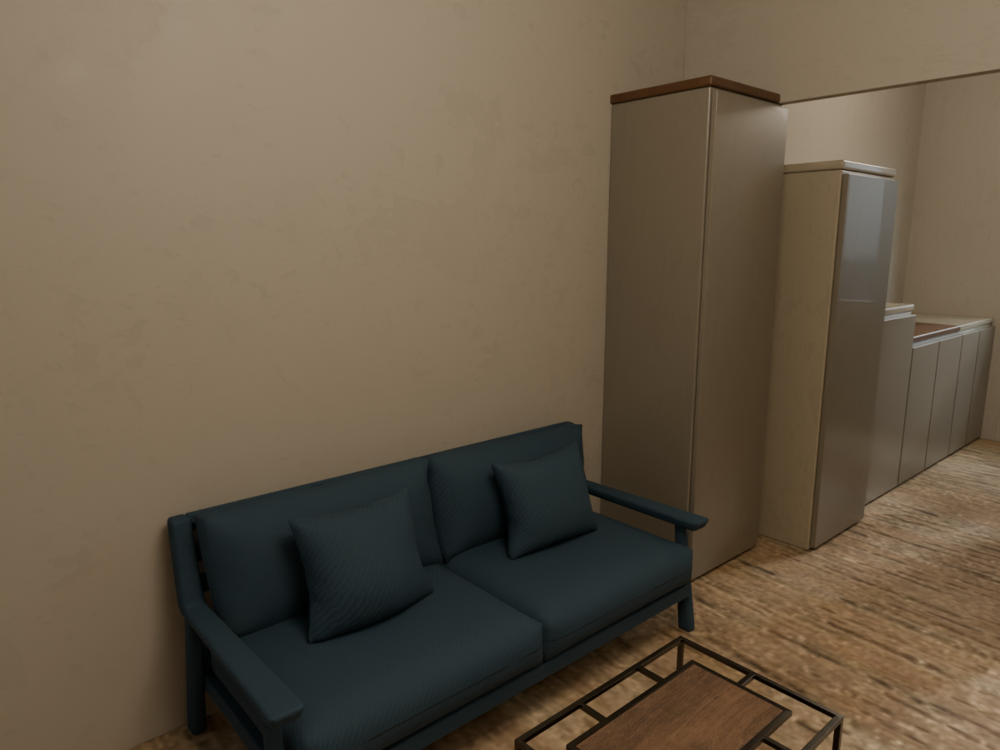

# 入口三：已有 3D 模型

先在「我的專案」建立專案並進入「01 匯入」；完整步驟見[三種範例說明](../README.md)。

上傳 **[project04-apartment.glb](project04-apartment.glb)**。同一份 Project04 教學平面重建，包含牆、門窗開口、24 個家具組、天花板、燈具／燈光與材質。使用原有 CC0 床、沙發、茶几、椅子；其他櫃體與設備為程序化概念模型，不宣稱是原案最新精細設計。



## 直接測試 GLB 上傳

1. 「01 匯入」點「開啟 3D 模型」卡片主區域，直接開啟檔案選擇器。
2. 選擇 `project04-apartment.glb`，等待檢查完成，會進入 02 編輯。
3. 2D 檢查範圍、點家具、切換 3D／雙擊進入單物件展示。各張椅子是獨立組，零件歸在相應家具內。
4. 材質、光源、觀看點可再編輯；確認後進入整合輸出。先低解析出圖再調整。

GLB 含打包貼圖及 punctual lights，但 **不能保存 Blender 的 HDRI 世界設定**。直接 GLB 匯入不應預期與原生預覽完全相同；可在光源頁配置照明。

## 保留原生 HDRI 的方式

安裝並設定 Blender 後，在 repo 根目錄啟動：

```shell
python -m interior.workbench serve --workspace workspace
```

點「開啟 3D 模型」卡片內的「開啟範例」，會建立獨立副本並保留成對 BLEND／GLB、HDRI 與 Living／Master 觀看點。原範例不會覆寫；準備完成後自動進入 02 編輯。

## 離線重建、來源與儲存

```shell
blender --background --disable-autoexec --python-exit-code 1 --python examples/from-3d/build_example.py
```

輸入：`../from-dxf/layout.json`、`assets/manifest.json` 及其中的素材。`assets/` 沿用舊公開範例的免費 CC0 素材，每個來源、作者、網址及雜湊都保留；不讀私人 Project04 模型、不下載新素材、不呼叫 Agent。

輸出：GLB、壓縮且打包貼圖的 BLEND、1200×900／48 samples Cycles 預覽、俯視圖與雜湊 manifest。模型總高、家具高度及窗高是教學設定；城市 HDRI 為示意天空，不是真實窗外照片。圖片與 DXF 入口建立的概念 3D 會較簡單。

這些是可重建的教學產物。不要只刪素材但保留需要離線重建的腳本；使用者的匯入副本、修訂與成果都留在其 workspace。原 Project04 唯讀模型不在此 repo，也不會被此腳本修改。
